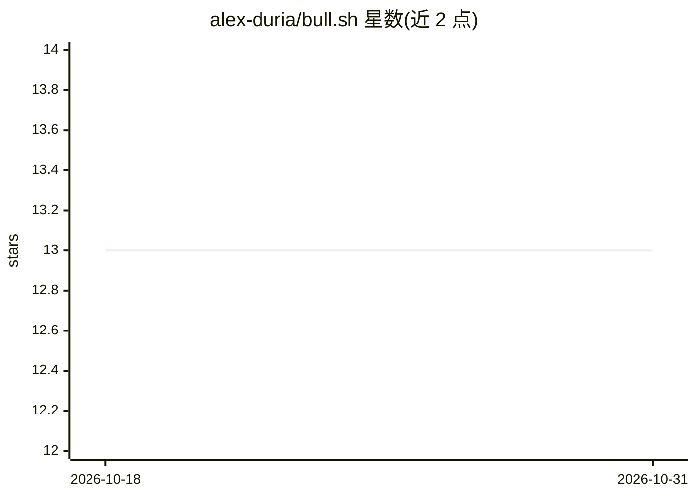

# alex-duria/bull.sh

⭐ 13 · Python · MIT · 推送 2026-01-12 · [GitHub](https://github.com/alex-duria/bull.sh) · 个人维护

**终端里的 AI 投资研究代理：接入 SEC/行情数据生成分析报告**

基于 Claude 的命令行投资研究代理（Python 3.12+，需 Anthropic API key）。内置 Stampede 的 Plan→Execute→Reflect 代理架构，自动抓取并解析 SEC EDGAR 10-K/10-Q/8-K 文件、Yahoo Finance 行情与分析师评级、StockTwits/Reddit 情绪、DuckDuckGo 新闻；支持对 SEC 文件做本地向量库 RAG 检索、多公司并行对比研究、牛熊对抗式多代理辩论。提供 Piotroski/Porter/估值等预设分析框架，可用 TOML 自定义，并导出 Excel/PDF/DOCX 报告。以 PyPI 包或源码安装，需配置 SEC EDGAR 身份信息。

## 筛选速览

| 维度 | 判定 | 备注 |
|---|---|---|
| AI 角色 | `ai-native` | 本体是模型或模型工具 |
| 许可风险 | `permissive` | MIT |
| 部署形态 | `library` | 以包/库形式分发 |
| 模型依赖 | locked-api |  |
| 硬件要求 | — | 无带数字的原话,不猜 |
| 安装摩擦 | `low` | 无编译、无系统依赖或容器化 |
| 成熟度 | — | 结构信号不足 |

## 能力要点

- Stampede 代理架构：理解→计划→并行执行→反思→综合输出
- SEC EDGAR 文件抓取与本地向量库 RAG 语义检索（可选依赖）
- 牛熊对抗式多代理辩论与 Piotroski/Porter/估值等分析框架
- 导出 Excel 财务模型、PDF/DOCX 报告，含会话保存与恢复

## 适用场景

- 用一条命令研究某公司并生成带来源的投资论点
- 对比多家公司的财务指标与分析结论
- 运行标准化框架（如 Piotroski F-Score）得到可复现的分析

## 场景标签

`金融量化` `RAG` · 领域:知识与检索

## 证据(README 行号)

> L19: **Bull.sh** is an AI-powered investment research agent that lives in your terminal. It combines the reasoning capab
> L348: Bull.sh uses **Stampede**, a Plan→Execute→Reflect architecture inspired by autonomous coding agents. Instead of a 
> L378: ## API Costs

## 星数曲线

2026-10-18 13 → 2026-10-31 13（+0）

---
*卡片 v1 · prompt 1.4 · 生成 2026-10-31 · 置信度 high · 依据 README sha `ed79f6166d30` · [字段定义](../../DATASET.md)*
