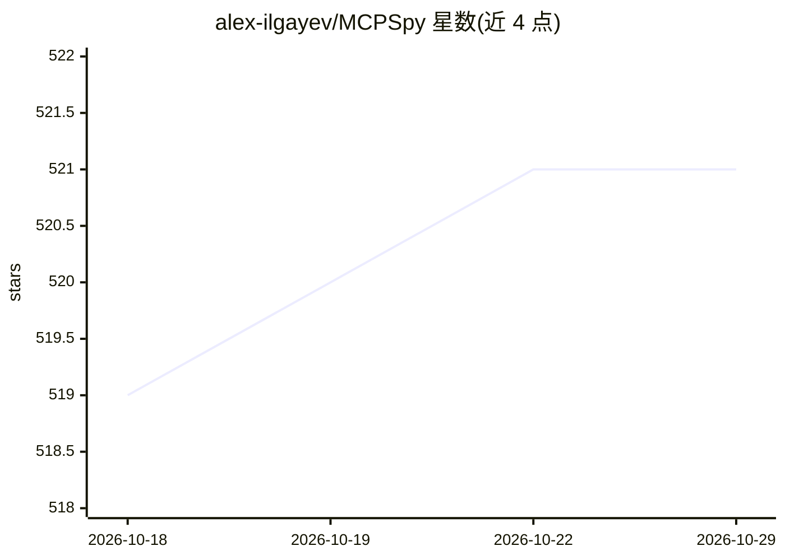

# alex-ilgayev/MCPSpy

⭐ 521 · C · Apache-2.0 · 推送 2026-01-16 · [GitHub](https://github.com/alex-ilgayev/MCPSpy) · 个人维护

**eBPF 实时监控 MCP 客户端/服务端通信的命令行工具**

基于 eBPF 在内核层挂钩 vfs_read/vfs_write 与 SSL_read/SSL_write，实时捕获 MCP 客户端与服务端之间的 JSON-RPC 2.0 消息，支持 Stdio 与 HTTP/HTTPS（含 SSE）两种传输。输出 TUI 交互界面、静态控制台或 JSONL 格式；可选启用基于 HuggingFace Inference API 的提示注入检测。面向 Linux（内核 5.15+、需 root），提供预编译二进制、源码构建、Docker 与 Kubernetes DaemonSet 部署方式。限制：单消息超 16KB 会被忽略，仅支持 Linux。

## 筛选速览

| 维度 | 判定 | 备注 |
|---|---|---|
| AI 角色 | `ai-ecosystem` | LLM/agent 周边工具 |
| 许可风险 | `permissive` | Apache-2.0 |
| 部署形态 | `desktop` | 安装包/桌面程序 |
| 模型依赖 | — | README 未给出锁定关系 |
| 硬件要求 | — | 无带数字的原话,不猜 |
| 安装摩擦 | `medium` | 含编译或系统依赖之一 |
| 成熟度 | — | 结构信号不足 |

## 能力要点

- eBPF 内核级捕获 Stdio 与 HTTP/HTTPS（含 SSE）上的 MCP 消息
- 可选实时提示注入检测（HuggingFace Inference API，基于 protectai 模型）
- TUI / 控制台 / JSONL 三种输出与实时统计
- 提供 Docker 镜像与 Kubernetes DaemonSet 部署

## 适用场景

- 审计与排查 MCP 集成中实际传输的数据，检测 PII 泄漏
- 在 Kubernetes 集群中监控 LangFlow/LangGraph 等服务的 MCP 流量
- 实时检测工具调用中的提示注入与越狱尝试

## 场景标签

`LLM 可观测性` `网络安全` · 领域:评测与运维

## 证据(README 行号)

> L19: MCPSpy is a powerful command-line tool that leverages eBPF (Extended Berkeley Packet Filter) technology to monitor 
> L35: - **🔒 Security Analysis**: Monitor what data is being transmitted, detect PII leakage, and audit tool executions
> L118: MCPSpy can be deployed in Kubernetes clusters to monitor MCP traffic from AI/LLM services like LangFlow, LangGraph

## 星数曲线

2026-10-18 519 → 2026-10-29 521（+2）

---
*卡片 v1 · prompt 1.4 · 生成 2026-10-21 · 置信度 high · 依据 README sha `8c17cf890c26` · [字段定义](../../DATASET.md)*
