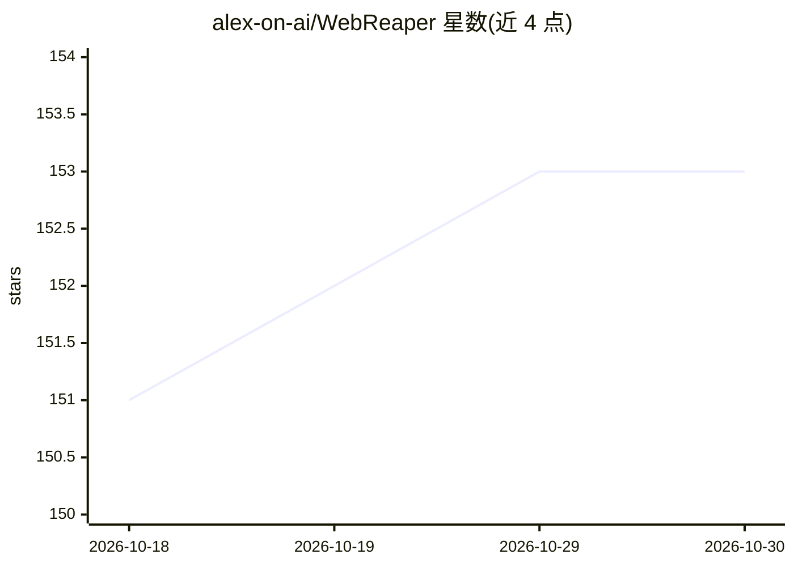

# alex-on-ai/WebReaper

⭐ 153 · C# · MIT · 推送 2026-10-04 · [GitHub](https://github.com/alex-on-ai/WebReaper) · [官网](https://webreaper.ai) · 组织维护

**AI 增强的网页抓取工具：单二进制 CLI/.NET 库，输出 Markdown 与结构化数据**

面向开发者的自托管网页抓取器，以约 12MB 单二进制 CLI 与 NuGet 库两种形式提供，默认输出 Markdown，支持 schema 结构化抽取。核心抓取流程不依赖 LLM（纯 HTTP 路径即可运行）；AI 作为可选能力叠加：确定性抽取失败时的 LLM 兜底、按目标自主选页的 Agent、语义化页面操作，LLM 通过 Microsoft.Extensions.AI 接入 OpenAI/Anthropic/Ollama/Azure 等。检测到封锁时自动从 HTTP 升级到浏览器/隐身模式。附带 Claude Code skill 与 stdio/HTTP 两种 MCP server，供 Cursor、Claude Desktop、n8n 等客户端调用。MIT 许可。

## 筛选速览

| 维度 | 判定 | 备注 |
|---|---|---|
| AI 角色 | `ai-enhanced` | 去掉 AI 部分产品仍成立 |
| 许可风险 | `permissive` | MIT |
| 部署形态 | `desktop` | 安装包/桌面程序 |
| 模型依赖 | — | README 未给出锁定关系 |
| 硬件要求 | — | 无带数字的原话,不猜 |
| 安装摩擦 | `low` | 无编译、无系统依赖或容器化 |
| 成熟度 | — | 结构信号不足 |

## 能力要点

- 单二进制 CLI（6 个 RID）与 .NET 库两种分发形式，无需 Docker/数据库/注册
- 封锁自动升级：HTTP → Chromium → 隐身后端，按 host 记忆
- LLM 仅在确定性抽取失败时调用；schema 由 Roslyn 源生成器在编译期生成
- 提供 Claude Code skill 与 stdio/Streamable HTTP 两个 MCP server

## 适用场景

- 把博客/文档站转成 Markdown 喂给 LLM 或向量库
- 定时监控竞品价格或状态页变化
- 给 agent（Claude Code/Cursor/n8n）提供抓取工具
- 抓取 Cloudflare 保护下的站点内容

## 场景标签

`网页抓取` · 领域:效率与自动化

## 证据(README 行号)

> L52:  🪶 Drop on PATH, run. No Docker, no Postgres, no signup. ~12 MB binary.
> L82: That is HTTP-only, no extra packages, no schema. For structured fields, swap `AsMarkdown()` for `Extract(schema)`; 

## 星数曲线

2026-10-18 151 → 2026-10-30 153（+2）

---
*卡片 v1 · prompt 1.4 · 生成 2026-10-23 · 置信度 high · 依据 README sha `e7dec02a41f8` · [字段定义](../../DATASET.md)*
