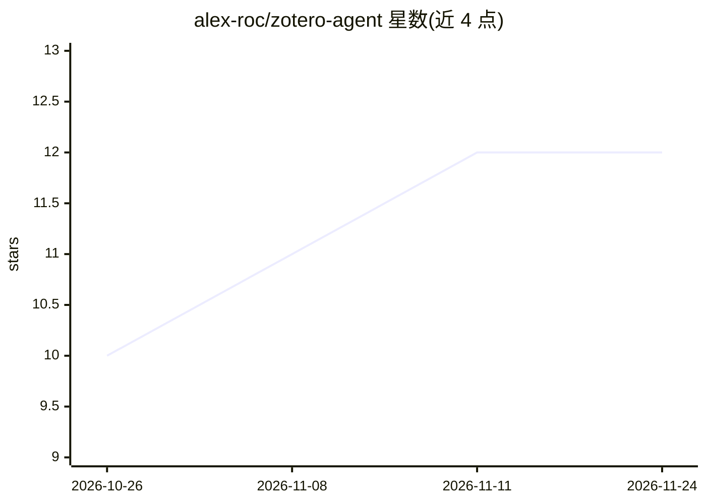

# alex-roc/zotero-agent

⭐ 12 · Python · AGPL-3.0 · 推送 2026-10-26 · [GitHub](https://github.com/alex-roc/zotero-agent) · [官网](https://alex-roc.github.io/zotero-agent) · 个人维护

**让终端或 AI agent 本地读写 Zotero 文献库的 CLI+MCP 工具**

以 CLI、MCP server、Claude Code skill 与 AGENTS.md 指令四种形态发布，提供对本地 Zotero 库的读写控制：搜索、批量编辑元数据、打标签、去重、按 DOI/ISBN/arXiv 导入、导出、字段补全等。写入通过 token 保护的桥接插件在本地完成，不走 zotero.org Web API，无需账号与 API key；批操作支持快照快照与 undo 恢复，写入需 --yes 确认。要求 Zotero 7+ 与 Python 3.10+，核心仅用标准库，PDF 目录与 OCR 功能依赖可选 extras 与 ghostscript/qpdf/OCRmyPDF 等外部工具。

## 筛选速览

| 维度 | 判定 | 备注 |
|---|---|---|
| AI 角色 | `ai-ecosystem` | LLM/agent 周边工具 |
| 许可风险 | `viral` | AGPL-3.0 |
| 部署形态 | `library` | 以包/库形式分发 |
| 模型依赖 | locked-api |  |
| 硬件要求 | — | 无带数字的原话,不猜 |
| 安装摩擦 | `low` | 无编译、无系统依赖或容器化 |
| 成熟度 | — | 结构信号不足 |

## 能力要点

- CLI + MCP server + Claude Code skill + AGENTS.md 四种接入形态
- 通过本地桥接插件实现 Zotero 本地写入，无需云端账号或 API key
- 批量编辑先快照、可 undo、支持 --dry-run 预览
- 本地 PDF 处理：生成目录、拆分对页、OCR（pdf-prep）

## 适用场景

- 让 AI agent 批量补全缺失 DOI、合并重复条目
- 把扫描书的 PDF 拆页并 OCR 成可搜索文本
- 从 shell 脚本化管理大规模 Zotero 文献库
- 为扫描版图书生成 PDF 目录并写入文件

## 场景标签

`科研工具` `OCR` `文档解析` · 领域:知识与检索

## 证据(README 行号)

> L15: or drivable by an AI agent. It ships as a **CLI**, an **MCP server**, a **Claude
> L36: Anything that speaks **MCP** or can **run a shell command** can drive your library:
> L40: |**Claude Code**|`zot skill install` (bundled skill), or `claude mcp add zotero-agent -- zot mcp`|

## 星数曲线

2026-10-26 10 → 2026-11-24 12（+2）

---
*卡片 v1 · prompt 1.4 · 生成 2026-11-18 · 置信度 high · 依据 README sha `b6e49c625e71` · [字段定义](../../DATASET.md)*
