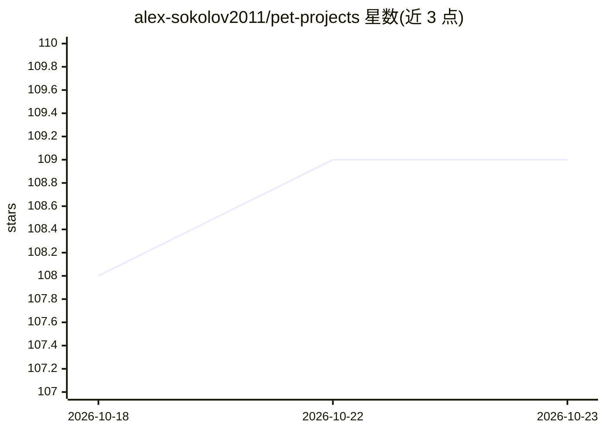

# alex-sokolov2011/pet-projects

⭐ 109 · Jupyter Notebook · 推送 2026-03-01 · [GitHub](https://github.com/alex-sokolov2011/pet-projects) · 个人维护

**个人 Data Science 项目集：竞赛与 MLOps 作品集**

作者自 2019 年起实现的课外 Data Science 项目合集，以表格列出交付时间预测 MLOps 流水线、GitHub 仓库文件夹复制工具、推荐系统与序列识别竞赛方案、信用卡违约预测、二手车价格预测（多输入神经网络）、汽车图像分类与网站数据抓取建模等项目，各条目附技术栈与名次。仓库内含全部项目源码与各自说明，README 另附简历与 LinkedIn 链接。无统一安装入口，需进入各项目目录查看。

## 筛选速览

| 维度 | 判定 | 备注 |
|---|---|---|
| AI 角色 | `ai-knowledge` | 知识聚合/清单类 |
| 许可风险 | `none` | — |
| 部署形态 | `None` |  |
| 模型依赖 | — | README 未给出锁定关系 |
| 硬件要求 | — | 无带数字的原话,不猜 |
| 安装摩擦 | `low` | 无编译、无系统依赖或容器化 |
| 成熟度 | — | 结构信号不足 |

## 能力要点

- 收录 2019 年以来的多个 ML 竞赛参赛方案（RecSys、信用评分、用户识别）
- E2E MLOps 项目含 CI/CD、监控与编排（Docker/MLflow/FastAPI/Prefect）
- 各条目标注技术栈、方法与竞赛名次

## 适用场景

- 查看作者的数据科学与 MLOps 能力作品集
- 参考 Kaggle 式竞赛的建模方案与技术栈选型
- 了解 E2E MLOps 流水线的组件组合方式

## 场景标签

`MLOps` `推荐系统` · 领域:学习与行业

## 证据(README 行号)

> L3: Проекты, которые я реализовал в Data Science (с ноября 2019 по текущий момент).
> L6: |Тема проекта/Год|Название проекта|Описание|Стек и методы|

## 星数曲线

2026-10-18 108 → 2026-10-23 109（+1）

---
*卡片 v1 · prompt 1.4 · 生成 2026-10-23 · 置信度 mid · 依据 README sha `934c6083671a` · [字段定义](../../DATASET.md)*
