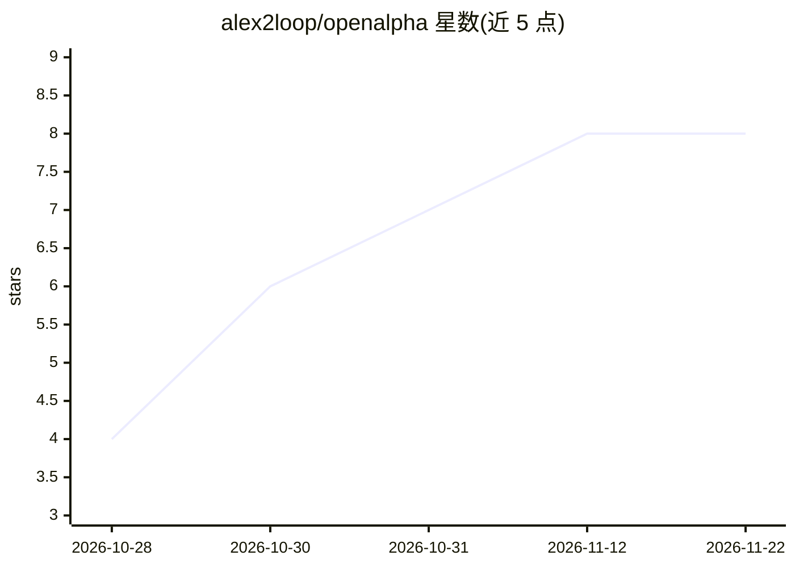

# alex2loop/openalpha

⭐ 8 · TypeScript · MIT · 推送 2026-11-20 · [GitHub](https://github.com/alex2loop/openalpha) · [官网](https://openalpha.link) · 个人维护 · 中文 README

**自托管 AI 投研团队：多角色分析辩论后给出交易计划**

在本地运行的开源 AI 投资助手，覆盖越南与美股 ETF、加密货币、越南黄金等五个市场。机制上由六个角色（多空、综合、交易、风险、事实核查）组成 AI 委员会辩论，代码计算价格与仓位，AI 给出理由；弱观点在六步流程中被过滤。产出为含入场、止损、止盈、仓位的计划，默认仅建议，下交易所订单需用户逐步确认；记录的是用户手动记账的持仓本，不连接券商账户。安装为自包含二进制脚本，配合 Telegram/Zalo 通知与浏览器办公页。

## 筛选速览

| 维度 | 判定 | 备注 |
|---|---|---|
| AI 角色 | `ai-native` | 本体是模型或模型工具 |
| 许可风险 | `permissive` | MIT |
| 部署形态 | `desktop` | 安装包/桌面程序 |
| 模型依赖 | locked-api |  |
| 硬件要求 | — | 无带数字的原话,不猜 |
| 安装摩擦 | `low` | 无编译、无系统依赖或容器化 |
| 成熟度 | — | 结构信号不足 |

## 能力要点

- 六个 AI 角色辩论机制：bull/bear/综合者/交易者/风险/事实核查
- API 密钥与持仓数据保留本地，AI 仅见权重不见余额
- 每个建议持续跟踪打分，/reflect 查看历史准确率并影响后续置信度
- 五个市场：越南股票（本地数据源最深）、美股 ETF、加密、越南金、世界金

## 适用场景

- 给自己持有的组合生成带入场/止损/仓位的交易计划
- 让 AI 先辩论再下单，最终由自己确认每笔订单
- 用 Telegram/Zalo 在手机上接收建议提醒

## 场景标签

`多智能体` `金融量化` · 领域:Agent 开发

## 证据(README 行号)

> L4:  Meet OpenAlpha, an open-source AI investment assistant you install on your own computer, for Vietnamese and US stoc
> L18: - **An AI council debates.** Bull, bear, a synthesizer, a trader, a risk analyst and a fact-checker. Code computes 
> L14: You ask about a name, and OpenAlpha gives you a plan back: where to buy, where to stop out, where to take profit, a

## 星数曲线

2026-10-28 4 → 2026-11-22 8（+4）

---
*卡片 v1 · prompt 1.4 · 生成 2026-11-20 · 置信度 mid · 依据 README sha `799f3f7af9f9` · [字段定义](../../DATASET.md)*
