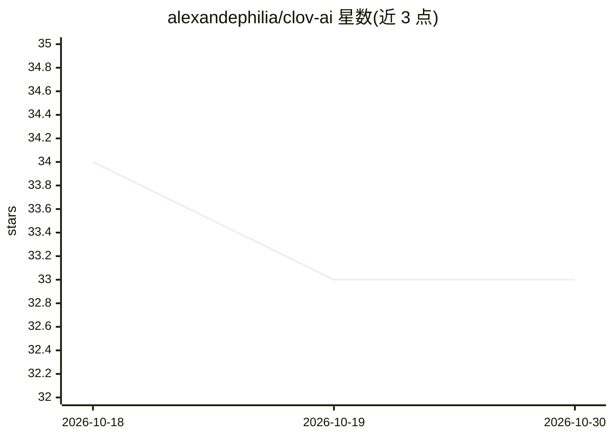

# alexandephilia/clov-ai

⭐ 33 · Rust · MIT · 推送 2026-09-17 · [GitHub](https://github.com/alexandephilia/clov-ai) · 个人维护

**MCP 响应与终端输出的上下文压缩代理，削减 LLM token 消耗**

用 Rust 实现的结构感知 JSON-RPC 代理，部署在 AI agent 与 MCP 服务器之间：拦截并压缩 MCP 响应，剥离导航/广告等低信号内容，对大数组采样并以截断摘要替代，支持 token 预算与 tokenizer profile 配置。另可对 git/npm/cargo 等终端输出注入全局拦截钩子，去除 ANSI 码与进度条；未识别命令自动放行，原始输出可经 Tee 模式临时文件找回。遥测数据存于本地 SQLite。提供 Homebrew 安装与预编译二进制，含 RTK 派生工作。

## 筛选速览

| 维度 | 判定 | 备注 |
|---|---|---|
| AI 角色 | `ai-ecosystem` | LLM/agent 周边工具 |
| 许可风险 | `permissive` | MIT |
| 部署形态 | `None` |  |
| 模型依赖 | — | README 未给出锁定关系 |
| 硬件要求 | — | 无带数字的原话,不猜 |
| 安装摩擦 | `low` | 无编译、无系统依赖或容器化 |
| 成熟度 | — | 结构信号不足 |

## 能力要点

- MCP stdio 透明代理，压缩文本与结构化工具结果
- token 预算、tokenizer profile、数组/对象键上限等动态截断控制
- 全局终端拦截钩子覆盖 git/npm/cargo/pytest/docker/kubectl 等工具链
- Tee 模式保留原始输出供 AI 按需读取；本地 SQLite 遥测

## 适用场景

- AI 编码会话中压缩 MCP 搜索/数据库响应以节省上下文窗口
- 拦截 git/cargo/npm 等命令输出，只把有效信息喂给 LLM
- 查看本地 token 节省统计与 30 天效率图表

## 场景标签

 · 领域:LLM 基础设施/MCP 工具链

## 证据(README 行号)

> L28: `clov` is the apex predator for context bloat. It is a highly specialized, structure-aware JSON-RPC proxy built _sp
> L67: To armor your MCP servers, wrap their invocation command with the `clov bridge proxy` bridge. `clov` operates as a 

## 星数曲线

2026-10-18 34 → 2026-10-30 33（-1）

---
*卡片 v1 · prompt 1.4 · 生成 2026-10-25 · 置信度 high · 依据 README sha `f315b8bbe50c` · [字段定义](../../DATASET.md)*
