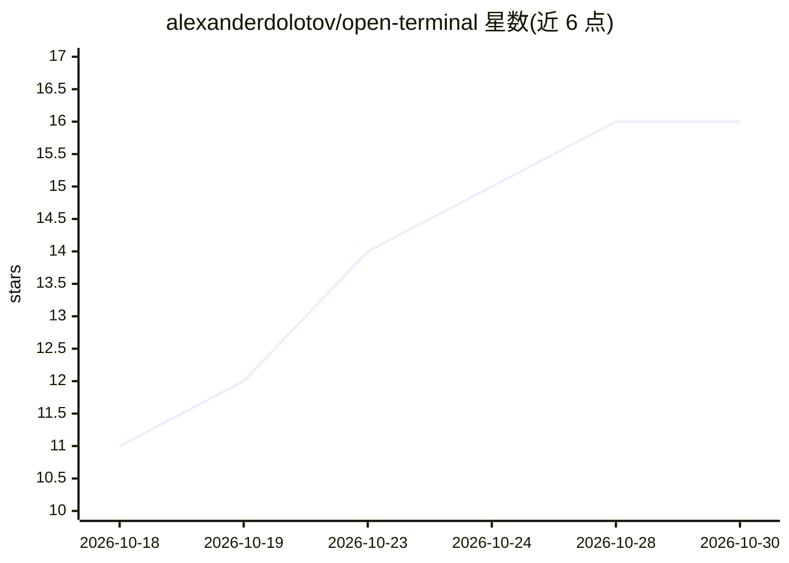

# alexanderdolotov/open-terminal

⭐ 16 · Python · MIT · 推送 2026-08-04 · [GitHub](https://github.com/alexanderdolotov/open-terminal) · [官网](https://tesseractanalytics.ai) · 个人维护

**给个人投资者的自托管金融研究终端，整合 SEC 财报、股价与 AI 分析**

面向个人投资者的自托管金融研究工具，以 Bloomberg 风格界面聚合三类数据流：SEC 财务申报（GAAP 概念按月聚合）、股价（Polygon.io 实时或内置 parquet 月均价回退）、带 LLM 情绪评分的新闻。提供六个标签页：财务图表、公司目录、象限散点筛选、AI Playground（自然语言生成 SQL 并绘图，需 OpenRouter key）、SQL Explorer（仅 SELECT 的 DuckDB 直查）与 ETL 管道。后端为 Flask + DuckDB 内存查询 parquet，新闻情绪本地由 Ollama（默认 qwen3:8b）或 OpenRouter 模型评分。无 Polygon key 时应用可用 parquet 数据运行，AI 标签页需 OpenRouter key。

## 筛选速览

| 维度 | 判定 | 备注 |
|---|---|---|
| AI 角色 | `ai-enhanced` | 去掉 AI 部分产品仍成立 |
| 许可风险 | `permissive` | MIT |
| 部署形态 | `library` | 以包/库形式分发 |
| 模型依赖 | local-ok | 支持本地模型 |
| 硬件要求 | — | 无带数字的原话,不猜 |
| 安装摩擦 | `low` | 无编译、无系统依赖或容器化 |
| 成熟度 | — | 结构信号不足 |

## 能力要点

- 自然语言提问生成 SQL 查询并渲染图表（经 OpenRouter）
- SEC EDGAR GAAP 概念按月聚合，查询链接回原始申报文件
- 自定义公式（Python 风格算术表达式）构建派生指标
- 新闻情绪由本地 Ollama（默认 qwen3:8b）或 OpenRouter 模型评分并附理由

## 适用场景

- 查多家公司财报概念并对比股价走势
- 用象限散点图在大范围公司中筛选异常值
- 用自然语言直接查询财务数据库生成图表
- 浏览公司目录并按板块标签过滤

## 场景标签

`金融量化` `数据分析` · 领域:效率与自动化

## 证据(README 行号)

> L3: **Open Terminal** is a self-hosted financial research tool built for the individual investor. It connects directly t
> L141: |LLM (local Ollama or OpenRouter)|News sentiment scores, company descriptions, 10-K summaries|Weekly|
> L151: |**Polygon.io**|Live stock prices, live news articles|Optional — app works without it using parquet data|

## 星数曲线

2026-10-18 11 → 2026-10-30 16（+5）

---
*卡片 v1 · prompt 1.4 · 生成 2026-10-30 · 置信度 high · 依据 README sha `906b68e11d27` · [字段定义](../../DATASET.md)*
