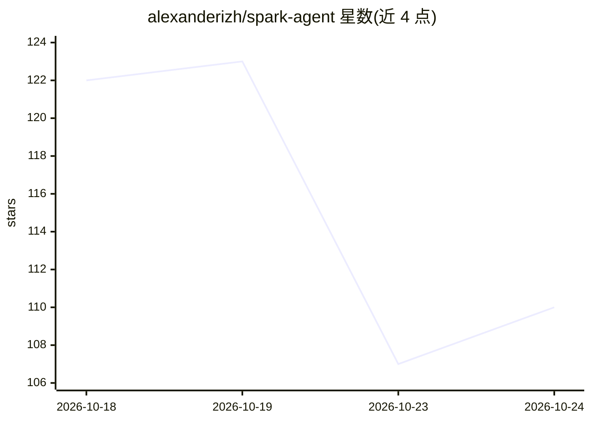

# alexanderizh/spark-agent

⭐ 110 · TypeScript · MIT · 推送 2026-10-23 · [GitHub](https://github.com/alexanderizh/spark-agent) · [官网](https://www.yiqibyte.com/) · 个人维护 · 中文 README

**本地优先桌面 Agent 工作台：编排工作流、多会话协作与模型路由**

基于 Electron + React 的跨平台（macOS/Windows/Linux）桌面 Agent 工作台，面向专业开发者与重度知识工作者。提供可视化工作流编排、Host 调度多成员 Agent 协作、按任务强度的模型自动路由与降级、自定义工具/插件/子应用扩展，以及终端、代码、浏览器、审查等侧边面板。多 Provider 管理（OpenAI 兼容 / Anthropic 协议），结构化数据存本地 SQLite，执行可审查、可接管、可回退。GitHub Releases 提供各平台安装包，也可从源码构建（Node.js 22 + pnpm），可选安装 spark CLI。

## 筛选速览

| 维度 | 判定 | 备注 |
|---|---|---|
| AI 角色 | `ai-native` | 本体是模型或模型工具 |
| 许可风险 | `permissive` | MIT |
| 部署形态 | `desktop` | 安装包/桌面程序 |
| 模型依赖 | — | README 未给出锁定关系 |
| 硬件要求 | — | 无带数字的原话,不猜 |
| 安装摩擦 | `low` | 无编译、无系统依赖或容器化 |
| 成熟度 | — | 结构信号不足 |

## 能力要点

- 可视化工作流编排：13 种节点类型、拓扑调度、快照断点续跑
- 自动路由：分流器按任务强度分派模型，失败降级不中断
- 多 Provider 管理：OpenAI 兼容 / Anthropic 协议渠道统一接入
- 本地优先：数据存本地 SQLite，密钥走系统凭据库，还原点时间线可回退

## 适用场景

- 在桌面端编排多 Agent 工作流并审批、回退执行过程
- 把 API 与脚本封装为 Agent 可调用的自定义工具
- 在一个工作台内边看终端/代码/浏览器边与 Agent 协作开发
- 通过 Telegram/飞书/QQ/微信远程驱动会话中的 Agent

## 场景标签

`多智能体` `工作流自动化` `AI 助手` · 领域:Agent 开发

## 证据(README 行号)

> L18: SparkWork 是面向专业开发者与重度知识工作者的桌面 Agent 工作台，运行于 macOS、Windows 和 Linux。它把任务编排、Agent 会话协作、模型智能路由、代码和文件工具、自定义应用，以及执行审查与回退放
> L254: 1. 安装应用，配置一种 Provider（OpenAI 兼容 / Anthropic 协议），或启用本地 Claude / Codex CLI

## 星数曲线

2026-10-18 122 → 2026-10-24 110（-12）

---
*卡片 v1 · prompt 1.4 · 生成 2026-10-23 · 置信度 mid · 依据 README sha `f5c9e577238e` · [字段定义](../../DATASET.md)*
