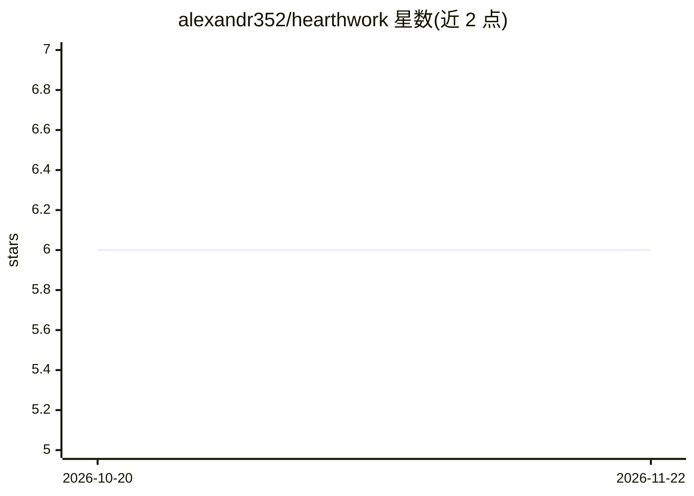

# alexandr352/hearthwork

⭐ 6 · Python · MIT · 推送 2026-10-22 · [GitHub](https://github.com/alexandr352/hearthwork) · 个人维护

**为 Claude Code 提供 plan→execute→judge 循环的工单执行器**

围绕 Claude Code CLI 构建的自动化执行层：operator 将工单拆为小单元并撰写提示词，executor 在围栏内的检出中执行，operator 依据 executor 报告与 git 事实进行判定并更新计划。机制包括判定者不读代码只看 git 事实、答案契约由代码校验、lab 用 A/B 守卫测试证明修复、中断后可恢复，并提供实时工作日志页面与可对话的 spirit。需要 Python 3.10+、git 与已登录的 claude CLI。

## 筛选速览

| 维度 | 判定 | 备注 |
|---|---|---|
| AI 角色 | `ai-ecosystem` | LLM/agent 周边工具 |
| 许可风险 | `permissive` | MIT |
| 部署形态 | `library` | 以包/库形式分发 |
| 模型依赖 | — | README 未给出锁定关系 |
| 硬件要求 | — | 无带数字的原话,不猜 |
| 安装摩擦 | `low` | 无编译、无系统依赖或容器化 |
| 成熟度 | `idea` | |

## 能力要点

- plan→execute→judge 循环：operator 规划、executor 围栏内执行、按 git 事实判定
- lab 在未提交工作与 HEAD 上运行守卫测试，修复须证明而非声称
- 实时页面展示每单元的提示词、报告、git 事实、判定与成本
- 支持 MCP 接入自有 Claude Code 会话与 cron 无人值守运行

## 适用场景

- 让 operator 逐单元处理工单，自动提交到本地分支待人工审查
- 通过 Playwright 截帧与评审将 UI 测试发现转为 VISUAL 工单
- 用 cron 定时无人值守地跑工单单元并限制成本

## 场景标签

`编码 Agent` · 领域:编码与开发

## 证据(README 行号)

> L3: A plan → execute → judge loop for Claude Code, with a
> L41: Python 3.10+, git, and the Claude Code CLI (`claude`), logged in.

## 星数曲线

2026-10-20 6 → 2026-11-22 6（+0）

---
*卡片 v1 · prompt 1.4 · 生成 2026-11-20 · 置信度 high · 依据 README sha `8f14ba67bffd` · [字段定义](../../DATASET.md)*
