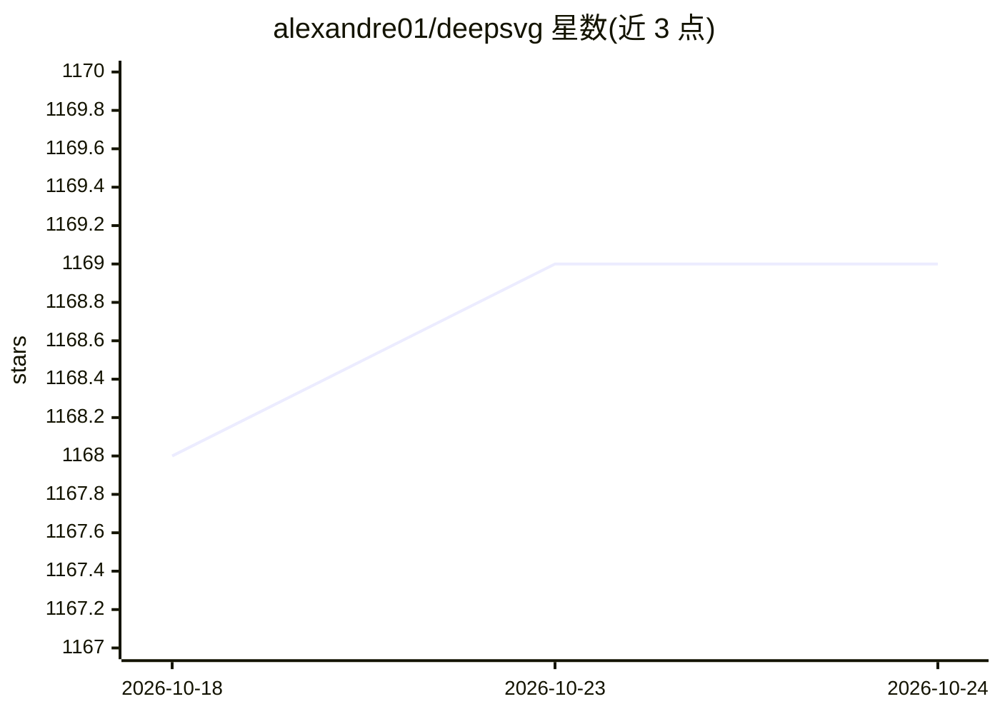

# alexandre01/deepsvg

⭐ 1,169 · Jupyter Notebook · MIT · 推送 2026-09-04 · [GitHub](https://github.com/alexandre01/deepsvg) · 个人维护

**NeurIPS 2020 论文官方代码：SVG 矢量图形动画的层级生成网络及配套库**

DeepSVG 论文（NeurIPS 2020）的官方 PyTorch 实现，提供训练代码、预训练模型、SVG-Icons8 数据集（10 万图标）以及一个深度学习 SVG 库：支持 SVG 解析、路径简化（Ramer-Douglas-Peucker / Schneider 算法）、数据增强、转 PyTorch 张量与可微形状优化。附带 Kivy 编写的实验性 GUI（自述为演示用途，功能有限）。可执行图标插值、字体生成、潜空间操作等推理任务。安装需 conda Python 3.7 环境、pip 依赖及系统级 Cairo 库。

## 筛选速览

| 维度 | 判定 | 备注 |
|---|---|---|
| AI 角色 | `ai-native` | 本体是模型或模型工具 |
| 许可风险 | `permissive` | MIT |
| 部署形态 | `library` | 以包/库形式分发 |
| 模型依赖 | — | README 未给出锁定关系 |
| 硬件要求 | — | 无带数字的原话,不猜 |
| 安装摩擦 | `medium` | 含编译或系统依赖之一 |
| 成熟度 | `idea` | |

## 能力要点

- 层级生成网络训练与推理代码，含预训练模型
- SVG 解析、路径简化、数据增强、转 PyTorch 张量的 svglib 库
- 可微 SVGTensor 支持梯度下降形状优化
- SVG-Icons8 数据集（10 万图标的预增广张量格式）

## 适用场景

- 复现论文的矢量图形生成与动画实验
- 用 svglib 处理/增强自定义 SVG 数据集
- 做 SVG 潜空间插值与图标变形动画研究

## 场景标签

`图像生成` · 领域:内容生成

## 证据(README 行号)

> L18: This is the official code for the paper "DeepSVG: A Hierarchical Generative Network for Vector Graphics Animation".
> L39: - The **training code** to reproduce our Hierarchical Generative Network: DeepSVG.
> L40: - A **library for deep learning with SVG data**, including export functionality to differentiable PyTorch tensors.

## 星数曲线

2026-10-18 1,168 → 2026-10-24 1,169（+1）

---
*卡片 v1 · prompt 1.4 · 生成 2026-10-21 · 置信度 mid · 依据 README sha `66d362c57289` · [字段定义](../../DATASET.md)*
