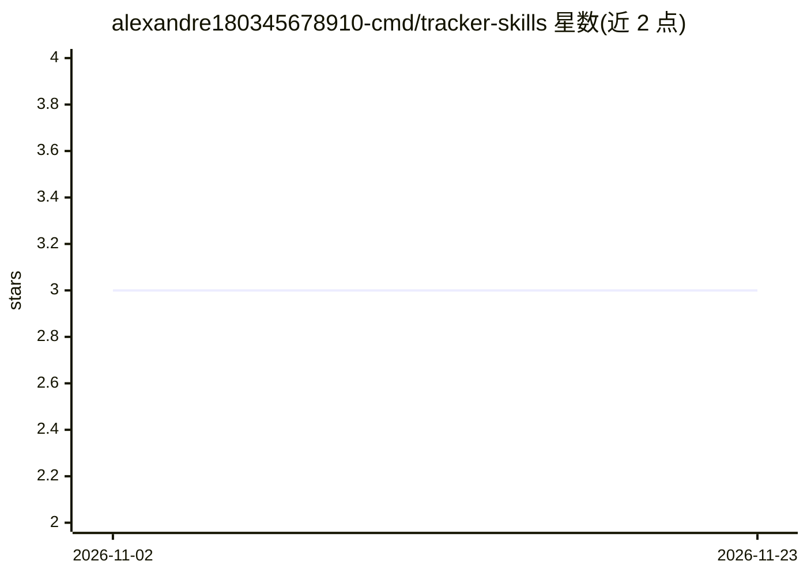

# alexandre180345678910-cmd/tracker-skills

⭐ 3 · Python · MIT · 推送 2026-11-01 · [GitHub](https://github.com/alexandre180345678910-cmd/tracker-skills) · 个人维护

**给 Claude Code/Codex 等 agent 的工程化技能包**

提供三个面向 AI 编码 agent 的技能：ship-with-confidence（从规格到交付的门禁式工作流）、claude-codex-pair（两 agent 读写分离协作，一个写、一个只读质证）、code-health-audit（只读的代码健康与成本审计）。核心机制包括按风险分级流程、以命令与退出码为完成证据、安全检查作为发布门禁、API 成本预算约束。技能以 Markdown 文件加 Python/shell 辅助脚本形式分发，复制到 agent 的 skills 目录即可使用，仅依赖 Python 标准库。

## 筛选速览

| 维度 | 判定 | 备注 |
|---|---|---|
| AI 角色 | `ai-ecosystem` | LLM/agent 周边工具 |
| 许可风险 | `permissive` | MIT |
| 部署形态 | `None` |  |
| 模型依赖 | — | README 未给出锁定关系 |
| 硬件要求 | — | 无带数字的原话,不猜 |
| 安装摩擦 | `low` | 无编译、无系统依赖或容器化 |
| 成熟度 | — | 结构信号不足 |

## 能力要点

- ship-with-confidence 提供含威胁模型、回滚计划与审批的门禁式交付流程
- claude-codex-pair 用写权限唯一化与书面交接防止双 agent 冲突
- code-health-audit 以基线记录与独立复核验证性能与成本问题
- scripts/ 附带密钥检查、风险画像、证据校验等确定性脚本，仅用 Python 标准库

## 适用场景

- 给功能、修复、重构等任务建立可验证的交付流程
- 让 Claude 与 Codex 在同一仓库协作互审而不互相覆盖
- 审计现有代码库的死代码、性能与 API 运行成本

## 场景标签

`编码 Agent` `代码审查` · 领域:编码与开发

## 证据(README 行号)

> L3: # tracker-skills: evidence-first skills for AI coding agents
> L5: Three open skills that make Claude Code, Codex and other coding agents work like a careful senior engineer: plan bef
> L36: Copy the skills you want into your agent's skills folder.

## 星数曲线

2026-11-02 3 → 2026-11-23 3（+0）

---
*卡片 v1 · prompt 1.4 · 生成 2026-11-22 · 置信度 high · 依据 README sha `8fa92d15ebe3` · [字段定义](../../DATASET.md)*
