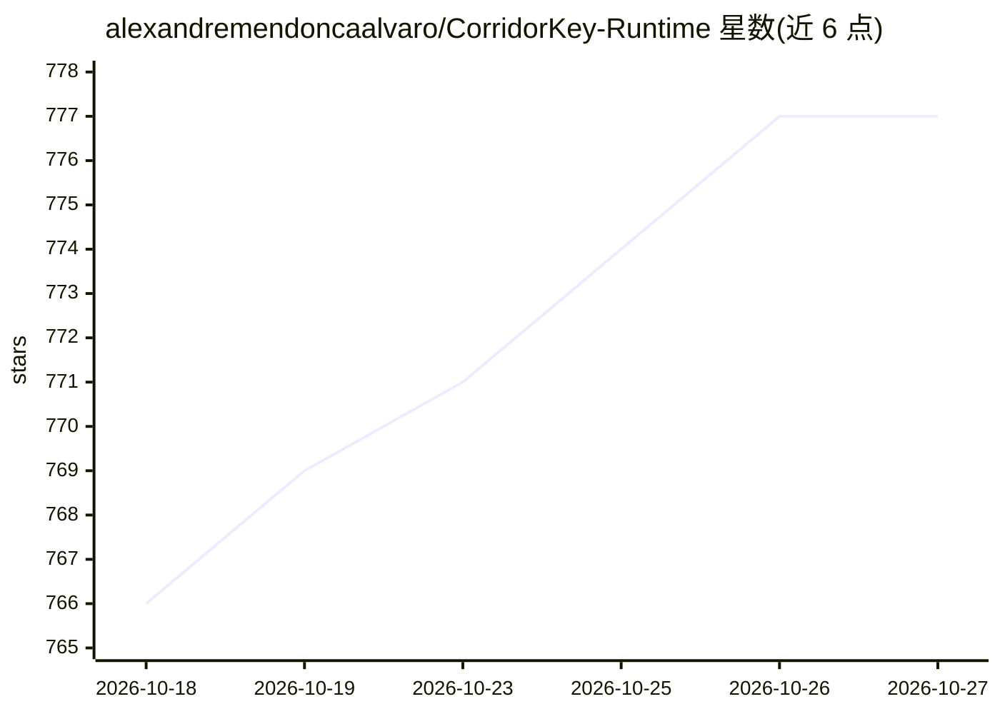

# alexandremendoncaalvaro/CorridorKey-Runtime

⭐ 777 · C++ · NOASSERTION · 推送 2026-08-05 · [GitHub](https://github.com/alexandremendoncaalvaro/CorridorKey-Runtime) · [官网](https://github.com/alexandremendoncaalvaro/CorridorKey-Runtime/releases/latest) · 个人维护

**AI 抠像/Keying 运行时与 OFX 插件，面向 DaVinci Resolve/Nuke 用户**

Corridor Digital 协作开发的本地 AI 抠像工具，提供三种产品面：DaVinci Resolve 与 Foundry Nuke 内的 OFX 插件、corridorkey 命令行（诊断、脚本化处理、NDJSON 输出）、Tauri 桌面 GUI。本地原生执行，支持 NVIDIA RTX（TensorRT、FP16 质量档位）与 Apple Silicon（MLX 加速）。Windows 套件安装器以 CLI/运行时为核心，OFX/GUI/模型包为可选组件；Adobe 插件为打包目标但未开放。从源码构建需 C++20 编译器、CMake 3.28+、vcpkg 与 Ninja。

## 筛选速览

| 维度 | 判定 | 备注 |
|---|---|---|
| AI 角色 | `ai-native` | 本体是模型或模型工具 |
| 许可风险 | `none` | NOASSERTION |
| 部署形态 | `desktop` | 安装包/桌面程序 |
| 模型依赖 | — | README 未给出锁定关系 |
| 硬件要求 | — | 无带数字的原话,不猜 |
| 安装摩擦 | `high` | 编译与系统依赖俱全 |
| 成熟度 | `idea` | |

## 能力要点

- OFX 插件可在 DaVinci Resolve / Nuke 内交互抠像
- corridorkey CLI 支持诊断、脚本化处理与 NDJSON 事件流输出
- Windows RTX 提供 FP16 质量档位（Draft 到 Maximum）与 VRAM 自动档
- Apple Silicon 走 MLX 加速路径

## 适用场景

- 在 DaVinci Resolve 或 Nuke 中对绿幕素材做 AI 抠像
- 用 CLI 批量/自动化处理视频抠像任务
- 在本地 GPU（RTX/Apple Silicon）上离线运行抠像模型

## 场景标签

`图像视频处理` · 领域:感知与多模态

## 证据(README 行号)

> L5: Native AI keying runtime and OFX plugin for **DaVinci Resolve and Foundry Nuke**, built in collaboration with **Corr
> L32: - Native local execution

## 星数曲线

2026-10-18 766 → 2026-10-27 777（+11）

---
*卡片 v1 · prompt 1.4 · 生成 2026-10-21 · 置信度 high · 依据 README sha `57dcdda8fdf0` · [字段定义](../../DATASET.md)*
