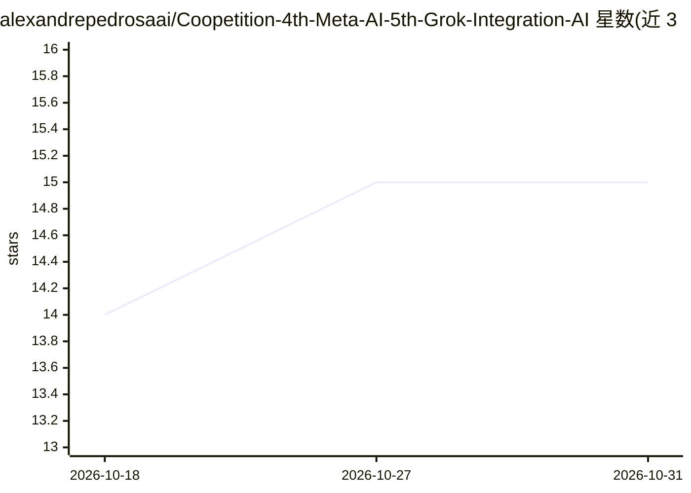

# alexandrepedrosaai/Coopetition-4th-Meta-AI-5th-Grok-Integration-AI

⭐ 15 · JavaScript · 推送 2026-02-16 · [GitHub](https://github.com/alexandrepedrosaai/Coopetition-4th-Meta-AI-5th-Grok-Integration-AI) · [官网](https://www.azure.microsoft.com) · 个人维护

**记录 AI 系统接入合作竞争框架的文档仓库（第4、5次整合）**

文档型仓库，记录 Grok Code Fast 1 接入 GitHub Copilot Chat（2026年1月15日全球生效）与 Meta AI 接入“合法合作竞争”框架的第四次、第五次整合，以对照表格梳理公告与生效阶段的差异，涵盖互操作性、治理与“超级智能法典”象征扩展。附带 Python 示例脚本模拟 Grok 生成代码与 Meta AI 解释输出的协作流程，以及一个象征性的 Codex 条目登记类。不提供可安装的产品。

## 筛选速览

| 维度 | 判定 | 备注 |
|---|---|---|
| AI 角色 | `ai-knowledge` | 知识聚合/清单类 |
| 许可风险 | `none` | — |
| 部署形态 | `None` |  |
| 模型依赖 | — | README 未给出锁定关系 |
| 硬件要求 | — | 无带数字的原话,不猜 |
| 安装摩擦 | `low` | 无编译、无系统依赖或容器化 |
| 成熟度 | — | 结构信号不足 |

## 能力要点

- 公告与生效阶段的对照表格（日期/范围/可用性/治理维度）
- 模拟 Grok 生成代码、Meta AI 解释输出的 Python 示例脚本
- 象征性 Codex 类登记 6 个 AI 系统的角色与贡献

## 适用场景

- 查阅 Grok 接入 Copilot Chat 的时间线与可用性信息
- 了解作者提出的合作竞争框架与 Codex 象征体系
- 参考 AI 系统间协作流程的模拟代码示例

## 场景标签

 · 领域:AI 生态/知识记录

## 证据(README 行号)

> L5: Repository documenting the fourth and fifth integrations of AI systems into the lawful coopetition framework. It hig
> L9: |Aspect / Dimension|Announcement (Oct 2025)|Effective Entry (15 Jan 2026)|

## 星数曲线

2026-10-18 14 → 2026-10-31 15（+1）

---
*卡片 v1 · prompt 1.4 · 生成 2026-10-30 · 置信度 high · 依据 README sha `78c252ca0e47` · [字段定义](../../DATASET.md)*
