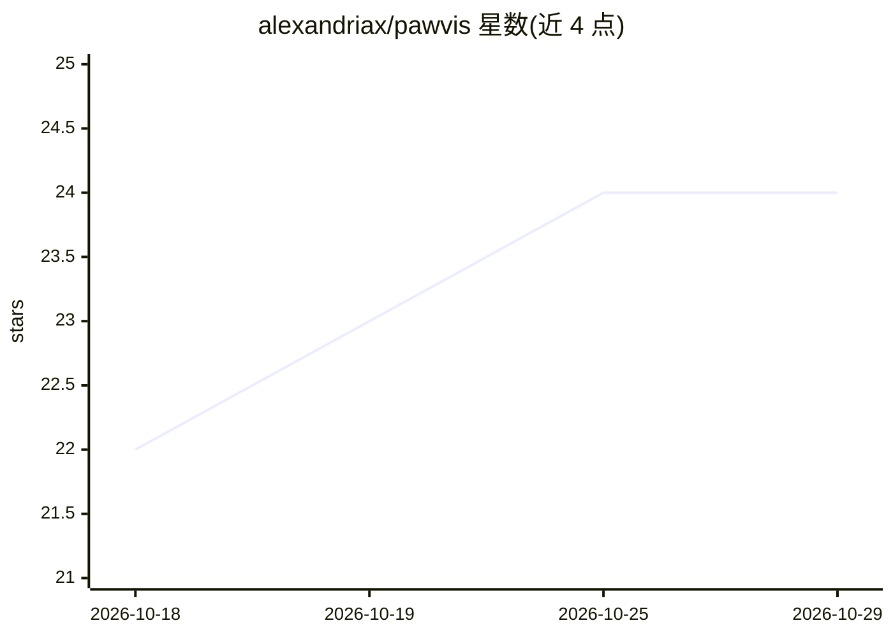

# alexandriax/pawvis

⭐ 24 · Swift · MIT · 推送 2026-09-03 · [GitHub](https://github.com/alexandriax/pawvis) · [官网](https://pawvis.app) · 个人维护

**macOS 免触手势与语音控制应用：用手与语音代替鼠标键盘**

macOS 桌面应用，将摄像头画面中的手部追踪转为指针控制：张手移动光标、屈指点击、双指折叠滚动、双手交叉停止追踪；内置手势库可绑定窗口管理/快捷键/打开应用/执行 shell 命令等动作，支持录制 3-10 次动作训练自定义手势。语音模式（beta）以唤醒词触发，经内置语法与 Apple Intelligence 逐步执行最多 8 步的屏幕操作。另有手势弹奏特雷门并导出 MP3 的功能。追踪与识别均在设备端完成。提供签名公证的下载包，macOS 14+ 可用。

## 筛选速览

| 维度 | 判定 | 备注 |
|---|---|---|
| AI 角色 | `ai-enhanced` | 去掉 AI 部分产品仍成立 |
| 许可风险 | `permissive` | MIT |
| 部署形态 | `desktop` | 安装包/桌面程序 |
| 模型依赖 | — | README 未给出锁定关系 |
| 硬件要求 | — | 无带数字的原话,不猜 |
| 安装摩擦 | `low` | 无编译、无系统依赖或容器化 |
| 成熟度 | `idea` | |

## 能力要点

- 摄像头手部追踪驱动光标移动/点击/拖拽/滚动
- 手势可绑定动作目录（窗口管理、快捷键、shell 命令），支持按应用区分
- 录制 3-10 次动作训练自定义手势，训练数据不出本机
- 语音命令（beta）由 Apple Intelligence 逐步读屏执行，最多 8 步

## 适用场景

- 手部不便或不便触碰鼠标时用手势操作 Mac
- 演讲、烹饪等双手占用场景下免触控制
- 用语音唤醒词逐步完成多步界面操作

## 场景标签

`GUI 自动化` · 领域:效率与自动化

## 证据(README 行号)

> L9: Pawvis turns your webcam into a pointing device that works from thin air.
> L20: Hand tracking runs entirely on-device with Apple's Vision framework; speech
> L186: |"Pawvis, *anything else*"|On-device Apple Intelligence carries it out **step by step**: it reads the screen (acce

## 星数曲线

2026-10-18 22 → 2026-10-29 24（+2）

---
*卡片 v1 · prompt 1.4 · 生成 2026-10-27 · 置信度 high · 依据 README sha `6f45990c844b` · [字段定义](../../DATASET.md)*
