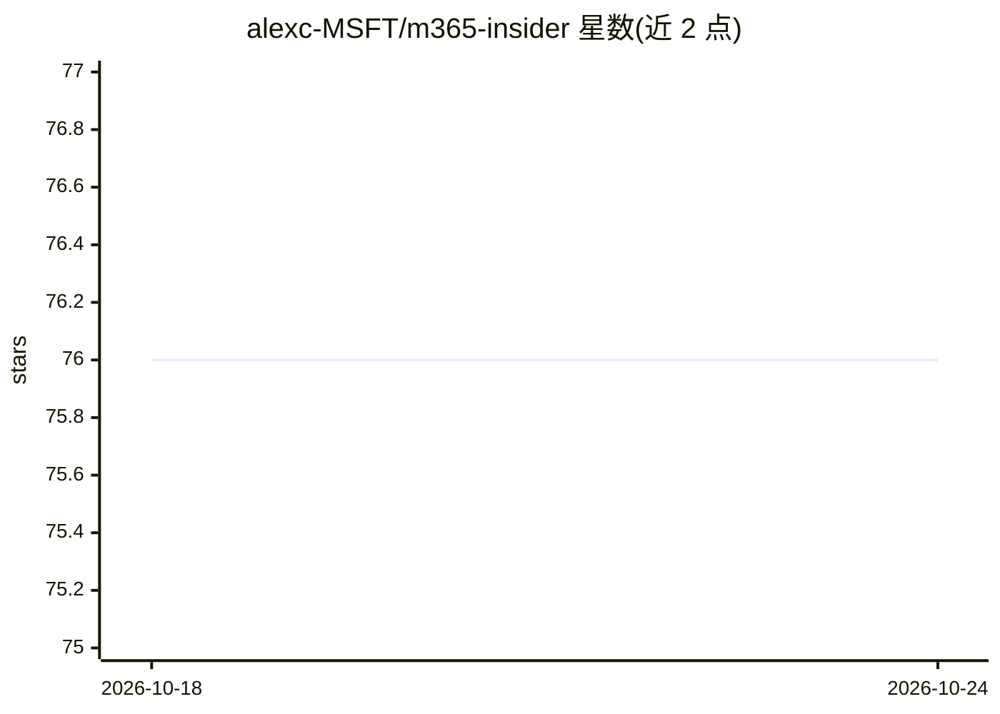

# alexc-MSFT/m365-insider

⭐ 76 · MIT · 推送 2026-07-21 · [GitHub](https://github.com/alexc-MSFT/m365-insider) · 个人维护

**供 Microsoft 365 Copilot 使用的路线图查询声明式 Agent**

使用 Agents Toolkit 构建的声明式 Agent，部署到 Microsoft 365 Copilot 中，供用户/管理员查询 Microsoft 365 Roadmap：按产品、状态、Feature ID 过滤路线图项，回答即将推出功能的问题。通过 API 插件调用 Microsoft 365 Roadmap 公开 REST API，用自适应卡片格式化回复。需在 VS Code 中用 Microsoft 365 Agents Toolkit 扩展部署并发布到租户，假定使用者具备 Agents Toolkit 使用经验。仓库已归档，README 声明被 m365-release-radar 取代，仅作历史参考。

## 筛选速览

| 维度 | 判定 | 备注 |
|---|---|---|
| AI 角色 | `ai-native` | 本体是模型或模型工具 |
| 许可风险 | `permissive` | MIT |
| 部署形态 | `None` |  |
| 模型依赖 | — | README 未给出锁定关系 |
| 硬件要求 | — | 无带数字的原话,不猜 |
| 安装摩擦 | `low` | 无编译、无系统依赖或容器化 |
| 成熟度 | — | 结构信号不足 |

## 能力要点

- 声明式 Agent，部署到 Microsoft 365 Copilot
- 通过 API 插件调用 M365 Roadmap 公开 REST API
- 按产品/状态/Feature ID 过滤并输出自适应卡片
- 需 VS Code + Microsoft 365 Agents Toolkit 扩展部署

## 适用场景

- 查询 Microsoft 365 即将推出的功能与发布状态
- 为采用规划和发布沟通生成路线图摘要
- 按 Teams/Outlook/SharePoint 等产品筛选路线图项

## 场景标签

`AI 助手` · 领域:对话与助手

## 证据(README 行号)

> L14: **M365 Insider** is a declarative agent built in the Agents Toolkit for Microsoft 365 Copilot that helps users/admi
> L18: It’s designed to be lightweight, web‑grounded, and easy to deploy with the **Microsoft 365 Agents Toolkit** in Visu

## 星数曲线

2026-10-18 76 → 2026-10-24 76（+0）

---
*卡片 v1 · prompt 1.4 · 生成 2026-10-24 · 置信度 high · 依据 README sha `8260cee4bd5d` · [字段定义](../../DATASET.md)*
