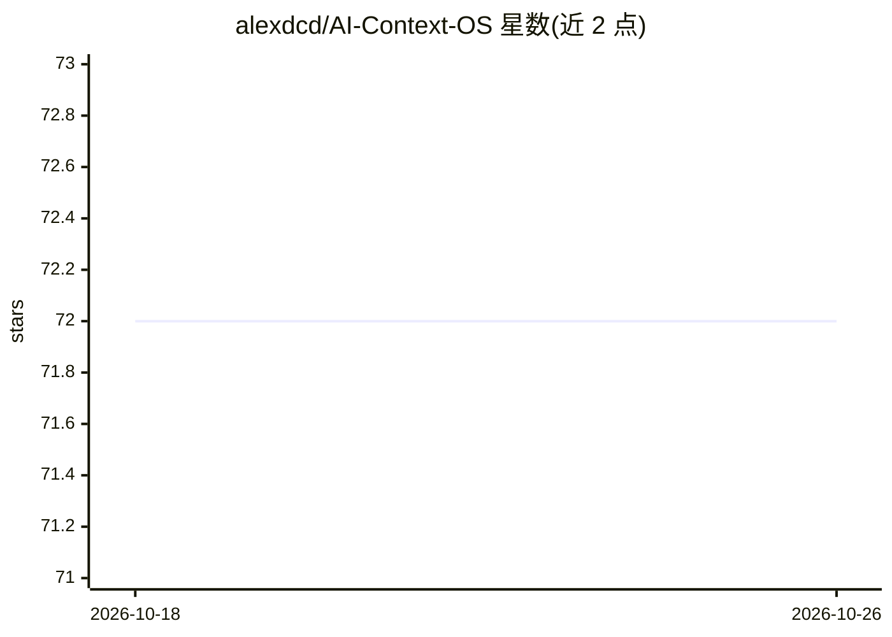

# alexdcd/AI-Context-OS

⭐ 72 · TypeScript · NOASSERTION · 推送 2026-06-07 · [GitHub](https://github.com/alexdcd/AI-Context-OS) · [官网](https://memm.dev/) · 个人维护

**给 AI agent 的文件系统式持久记忆桌面应用**

基于 React+TypeScript+Rust(Tauri v2) 的桌面应用，把本地文件夹变成工具无关的 agent 记忆层：记忆以 Markdown+YAML frontmatter 文件存储于工作区，采用 L0/L1/L2 三级摘要与确定性上下文加载，通过 router 与适配器生成 claude.md、.cursorrules 等工件，提供 MCP stdio/HTTP 服务、记忆 CRUD、治理检查与 SQLite 可观测性数据库。当前为早期公开快照，开发在私有仓库进行，bridge 层仅支持复制/交接流程而非完整原生集成。需从源码构建运行。

## 筛选速览

| 维度 | 判定 | 备注 |
|---|---|---|
| AI 角色 | `ai-ecosystem` | LLM/agent 周边工具 |
| 许可风险 | `none` | NOASSERTION |
| 部署形态 | `library` | 以包/库形式分发 |
| 模型依赖 | — | README 未给出锁定关系 |
| 硬件要求 | — | 无带数字的原话,不猜 |
| 安装摩擦 | `low` | 无编译、无系统依赖或容器化 |
| 成熟度 | `idea` | |

## 能力要点

- 文件系统优先：记忆、任务、日志均为工作区纯文件
- L0/L1/L2 三级渐进式记忆模型
- 适配器生成 claude.md / .cursorrules / .windsurfrules 工件
- 内置 MCP stdio 与 HTTP 服务（127.0.0.1:3847/mcp）

## 适用场景

- 为多个 AI 编码工具维护统一的项目记忆与上下文
- 通过 MCP 让 agent 读写持久化记忆文件
- 查看记忆图谱与冲突/衰减等治理建议

## 场景标签

`Agent 记忆` · 领域:Agent 开发

## 证据(README 行号)

> L20: AI Context OS is a desktop app (`React + TypeScript + Rust`) that turns a local folder into a universal, tool-agnos
> L22: This project is not a chat UI and not a wrapper around one provider. It is a filesystem-first brain layer with dete

## 星数曲线

2026-10-18 72 → 2026-10-26 72（+0）

---
*卡片 v1 · prompt 1.4 · 生成 2026-10-24 · 置信度 high · 依据 README sha `f6d00b5b38a9` · [字段定义](../../DATASET.md)*
