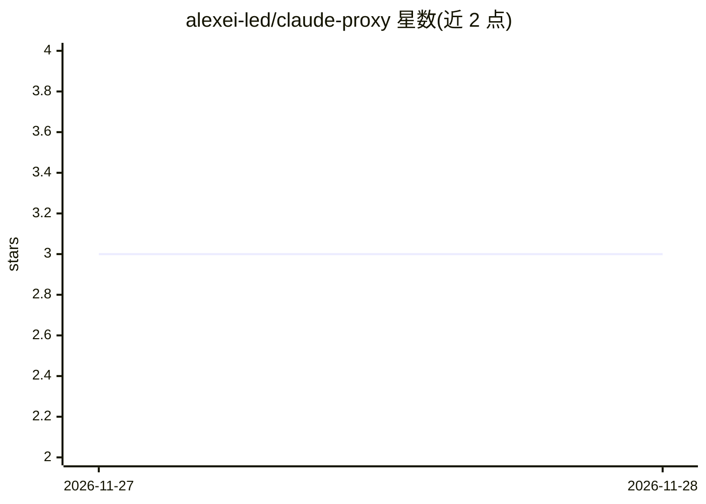

# alexei-led/claude-proxy

⭐ 3 · Go · MIT · 推送 2026-11-18 · [GitHub](https://github.com/alexei-led/claude-proxy) · 个人维护

**为 Claude Code 提供单一本地端点接入多家模型提供方**

以 Go 标准库编写的本地 Anthropic API 透传代理：Claude Code 将请求发往一个本地回环端点，按精确模型 ID 路由到不同配置的上游提供方，原始请求体与响应流不做翻译或改写，仅可选对 503/529 进行逐上游重试。凭证隔离：会话 OAuth 走显式透传路由，其他提供方的密钥由服务端持有。上游必须原生支持 Anthropic API，不转换 OpenAI API，也不修复不兼容的对话历史。OAuth 刷新、计费及未测试组合未经验证。

## 筛选速览

| 维度 | 判定 | 备注 |
|---|---|---|
| AI 角色 | `ai-ecosystem` | LLM/agent 周边工具 |
| 许可风险 | `permissive` | MIT |
| 部署形态 | `None` |  |
| 模型依赖 | locked-api |  |
| 硬件要求 | — | 无带数字的原话,不猜 |
| 安装摩擦 | `low` | 无编译、无系统依赖或容器化 |
| 成熟度 | — | 结构信号不足 |

## 能力要点

- 单一本地端点，按精确模型 ID 选择不同上游提供方
- 原生请求与流式传输，不翻译、不改写、不回退
- 凭证隔离：会话 OAuth 透传路由，其他密钥由服务端持有
- 单一标准库 Go 二进制，仅本地回环监听

## 适用场景

- 让 Claude Code 在多个模型提供方之间切换而保持单一连接
- 为不同上游提供方分别管理凭证
- 直接选择混合档案中的模型与推理强度

## 场景标签

`模型网关` · 领域:Agent 开发

## 证据(README 行号)

> L5: claude-proxy is a local Anthropic API passthrough proxy.
> L9: Claude Code sends a native request through one local proxy to one selected provider.
> L19: Providers must support the native Anthropic API.

## 星数曲线

2026-11-27 3 → 2026-11-28 3（+0）

---
*卡片 v1 · prompt 1.4 · 生成 2026-11-27 · 置信度 high · 依据 README sha `c696d832cb14` · [字段定义](../../DATASET.md)*
