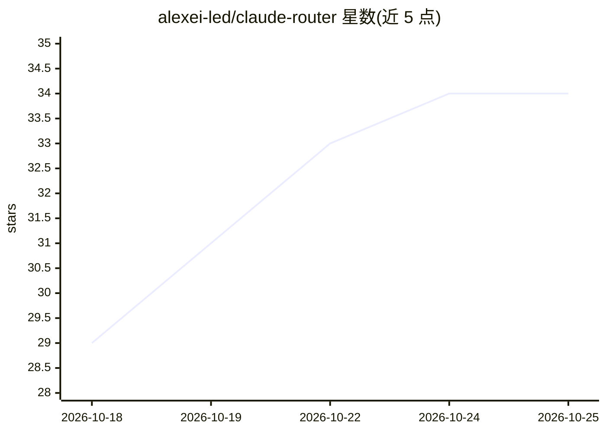

# alexei-led/claude-router

⭐ 34 · JavaScript · MIT · 推送 2026-10-22 · [GitHub](https://github.com/alexei-led/claude-router) · 个人维护

**Claude Code 插件：按轮次自动选择模型与 effort 档位**

以 Claude Code Mod 形式接入，在每轮主对话开始时由 prompt 分类器（Jev、Cloudflare Clef 系列、OpenAI 或本地 Ollama）判断 tier（micro/low/medium/high）与活动类型，据此选择模型与 effort；运行中每 4 次请求后台复核并调整路由。它只修改模型与 effort，不代理流量、不启动本地服务器（Ollama 分类器调用用户自建的 Ollama 服务）。提供状态栏、/router 面板、分层模型映射与 cost/quality/balanced 模式，费用对比为估算值且未实测节省。需 Claude Code 2.1.289 以上。

## 筛选速览

| 维度 | 判定 | 备注 |
|---|---|---|
| AI 角色 | `ai-ecosystem` | LLM/agent 周边工具 |
| 许可风险 | `permissive` | MIT |
| 部署形态 | `None` |  |
| 模型依赖 | local-ok | 支持本地模型 |
| 硬件要求 | — | 无带数字的原话,不猜 |
| 安装摩擦 | `low` | 无编译、无系统依赖或容器化 |
| 成熟度 | — | 结构信号不足 |

## 能力要点

- 五个可选分类器：Jev、Clef/Clef Flash/Clef Omni、OpenAI、本地 Ollama
- tier × activity 双维路由矩阵，运行中后台复核调整
- subagent 启动时同样路由一次，步骤不重路由
- Usage 标签页按配置目录价估算路由与自己模型的对比

## 适用场景

- 在 Claude Code 中按任务复杂度自动切换 Haiku/Opus 档位
- 通过本地 Ollama 分类器避免 prompt 文本外发
- 用 cost/quality/balanced 模式调节成本与回答取向

## 场景标签

`模型网关` · 领域:Agent 开发

## 证据(README 行号)

> L6: **A Claude Code Mod that chooses a model and effort for each main-conversation turn, advised by a prompt classifier:
> L8: The Mod changes only the model and effort in Claude Code's turn hook. Claude Code sends the request, streams the rep
> L21: |Ollama|A local Ollama model|None|Stays on this machine|A second request: letters A to H, one token, if 300 ms or m

## 星数曲线

2026-10-18 29 → 2026-10-25 34（+5）

---
*卡片 v1 · prompt 1.4 · 生成 2026-10-25 · 置信度 high · 依据 README sha `e9459e3f0d80` · [字段定义](../../DATASET.md)*
