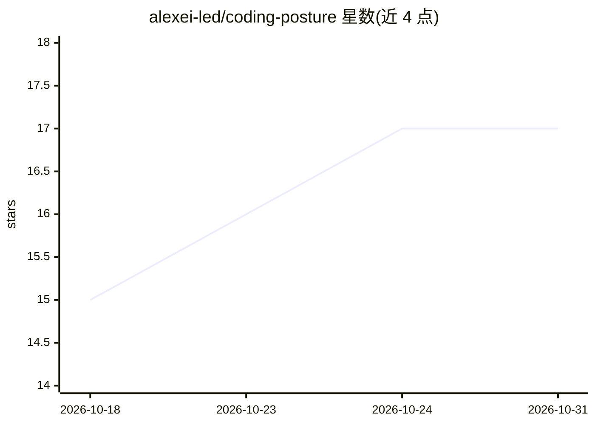

# alexei-led/coding-posture

⭐ 17 · JavaScript · MIT · 推送 2026-10-21 · [GitHub](https://github.com/alexei-led/coding-posture) · 个人维护

**给编码 agent 的单文件任务模式技能（SKILL.md）**

由单个 SKILL.md 文件构成的编码 agent 技能：agent 在开始非平凡任务前从 debug、fix、review、test-first、refactor、optimize、migrate 等 11 种模式中选取一种并遵循其检查清单（如 debug 先建立失败信号、migrate 先备回滚路径）。技能通过放入模型上下文起作用，兼容 Hermes、Claude Code、Codex、Cursor、Pi 等任何 SKILL.md 兼容的 agent。README 附带设计依据的证据强度表，并注明 0.6.0 版本效果尚未测量。

## 筛选速览

| 维度 | 判定 | 备注 |
|---|---|---|
| AI 角色 | `ai-ecosystem` | LLM/agent 周边工具 |
| 许可风险 | `permissive` | MIT |
| 部署形态 | `None` |  |
| 模型依赖 | — | README 未给出锁定关系 |
| 硬件要求 | — | 无带数字的原话,不猜 |
| 安装摩擦 | `low` | 无编译、无系统依赖或容器化 |
| 成熟度 | — | 结构信号不足 |

## 能力要点

- 11 种任务感知工作模式，各带核心纪律检查清单
- 单一 SKILL.md 文件，跨多种 SKILL.md 兼容 agent 无修改使用
- 提供 Claude Code / Codex 插件式安装与其他 agent 的手动放置方式
- README 列出各设计主张的证据强度与文献来源

## 适用场景

- 让编码 agent 在调试或迁移等任务前先选定模式并遵循清单
- 减少 agent 反复空转、伪造测试通过或无回滚迁移等行为
- 为已有 CLAUDE.md/AGENTS.md 补充按任务条件加载的模式目录

## 场景标签

`提示工程` · 领域:Agent 开发

## 证据(README 行号)

> L3: Task-aware working modes for coding agents. One `SKILL.md` file: before non-trivial work, the agent picks a mode — `
> L9: **Works with** Hermes · Claude Code · Codex · Cursor · Pi — any `SKILL.md`-compatible agent.
> L45: Install as a **plugin** (one command, updates in place) or drop the skill in directly. It's a standard `SKILL.md` s

## 星数曲线

2026-10-18 15 → 2026-10-31 17（+2）

---
*卡片 v1 · prompt 1.4 · 生成 2026-10-29 · 置信度 high · 依据 README sha `6e4ab57a7a8a` · [字段定义](../../DATASET.md)*
