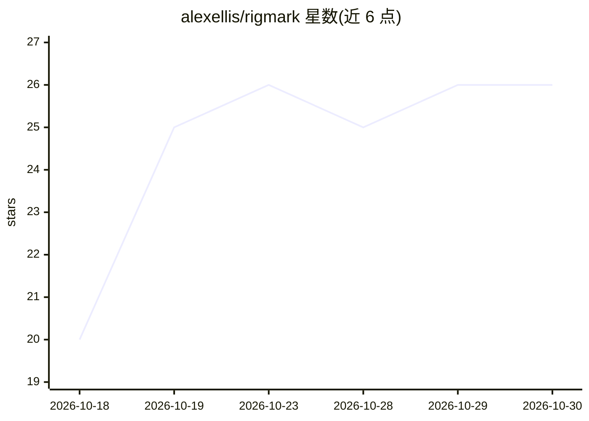

# alexellis/rigmark

⭐ 26 · Python · MIT · 推送 2026-10-25 · [GitHub](https://github.com/alexellis/rigmark) · [官网](https://github.com/alexellis/rigmark) · 个人维护

**面向编码 agent 用法的本地 AI 推理服务基准测试工具**

RigMark 是对 OpenAI 兼容本地推理服务做可复现基准测量的工具：以贴近编码 agent 的散文/代码负载、显式标注上限的结构化输出、cache-busting 与立即重放的 prefill 测量、并发请求行为四类工作负载测取指标，输出可截图的 ASCII 卡片与含完整输出和设置的 JSON 回执，并支持 A/B 对比与对模型生成代码的 Docker 隔离审计。模型无关，可配合 Qwen、GLM、DeepSeek、vLLM、SGLang 等本地栈使用。需 Python 3.10+，无第三方依赖，git clone 源码运行。限制：明确声明非完整多轮编码会话复现，也不测代码正确性。

## 筛选速览

| 维度 | 判定 | 备注 |
|---|---|---|
| AI 角色 | `ai-ecosystem` | LLM/agent 周边工具 |
| 许可风险 | `permissive` | MIT |
| 部署形态 | `self-host` | docker 或自建部署 |
| 模型依赖 | local-ok | 支持本地模型 |
| 硬件要求 | — | 无带数字的原话,不猜 |
| 安装摩擦 | `low` | 无编译、无系统依赖或容器化 |
| 成熟度 | — | 结构信号不足 |

## 能力要点

- agent 形态的代码/散文/结构化输出/prefill/并发四类基准负载
- 输出 ASCII 卡片与内容哈希的 JSON 回执，含 Git 版本锚定
- A/B 对比校验协议、种子、请求体等是否匹配
- 对模型生成代码在禁网 Docker 容器中重放其自带测试

## 适用场景

- 对比不同本地推理栈或量化方案的吞吐与延迟
- 为 DGX Spark 等设备上的推理配置发布可核验的性能回执
- 验证 prefill 缓存命中与并发服务能力

## 场景标签

`模型评测` · 领域:评测与运维

## 证据(README 行号)

> L7: RigMark is an independent, reproducible serving benchmark for the whole
> L10: exact cache-busting/immediate-replay prefill, and concurrent request behaviour.

## 星数曲线

2026-10-18 20 → 2026-10-30 26（+6）

---
*卡片 v1 · prompt 1.4 · 生成 2026-10-26 · 置信度 mid · 依据 README sha `cdf0e58d3d4c` · [字段定义](../../DATASET.md)*
