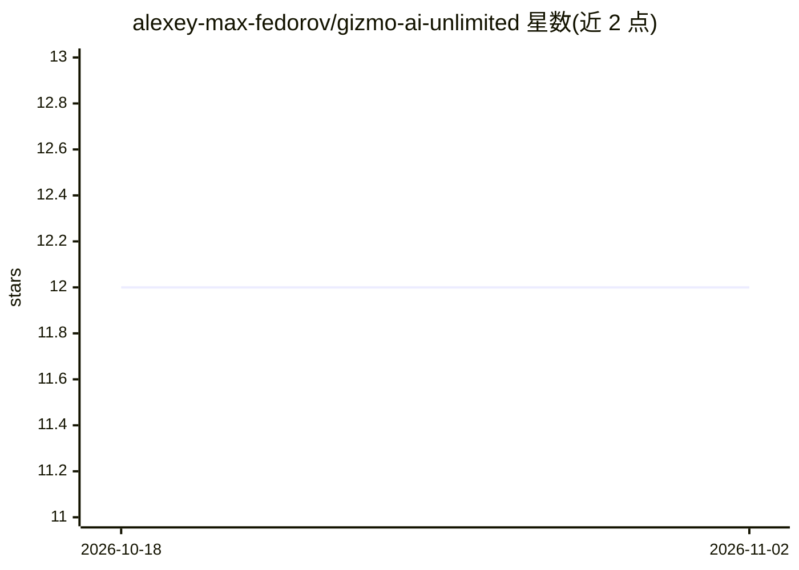

# alexey-max-fedorov/gizmo-ai-unlimited

⭐ 12 · TypeScript · NOASSERTION · 推送 2026-11-01 · [GitHub](https://github.com/alexey-max-fedorov/gizmo-ai-unlimited) · [官网](https://gizmo.best) · 个人维护

**解除 Gizmo AI 测验限制的浏览器扩展（安全研究项目）**

面向 app.gizmo.ai 的 Plasmo MV3 浏览器扩展（Chrome/Edge/Brave/Firefox）：在页面内强制改写内存中的订阅与导入冷却读取值，解锁无限红心、提示并移除 Magic Import 的客户端冷却；不改写服务端限制。仓库另含 Node CLI 补丁器，由 GitHub Action 每 2 小时拉取 Gizmo 的 JS bundle 应用正则补丁规则并提交 patches.json，使扩展在 Gizmo 更新后自愈。README 声明其为安全研究/概念验证项目，非消费级产品。安装需本地运行 pnpm build 后以开发者模式加载未打包扩展。

## 筛选速览

| 维度 | 判定 | 备注 |
|---|---|---|
| AI 角色 | `ai-enhanced` | 去掉 AI 部分产品仍成立 |
| 许可风险 | `none` | NOASSERTION |
| 部署形态 | `None` |  |
| 模型依赖 | — | README 未给出锁定关系 |
| 硬件要求 | — | 无带数字的原话,不猜 |
| 安装摩擦 | `low` | 无编译、无系统依赖或容器化 |
| 成熟度 | — | 结构信号不足 |

## 能力要点

- MAIN-world 内容脚本改写内存中的订阅与导入冷却读取值
- GitHub Action 每 2 小时自动重新补丁 Gizmo JS bundle，扩展自愈
- 支持 Chrome/Edge/Brave/Firefox 四种浏览器
- 不获取或执行远程代码，不收集个人数据

## 适用场景

- 在 Gizmo AI 测验中不因红心耗尽而中断学习
- 移除 Magic Import 的客户端导入冷却等待
- 研究 MV3 扩展对第三方前端 bundle 的补丁机制

## 场景标签

 · 领域:浏览器扩展/教育工具

## 证据(README 行号)

> L9: Unlocks unlimited hearts and hints on Gizmo AI quizzes and removes the client-side Magic Import cooldown on app.gizm
> L19: 1. **Patcher (`patcher/`)** — a Node CLI run every 2 hours by a GitHub Action. It fetches the live Gizmo JavaScript

## 星数曲线

2026-10-18 12 → 2026-11-02 12（+0）

---
*卡片 v1 · prompt 1.4 · 生成 2026-11-01 · 置信度 mid · 依据 README sha `7f5e1218c35a` · [字段定义](../../DATASET.md)*
