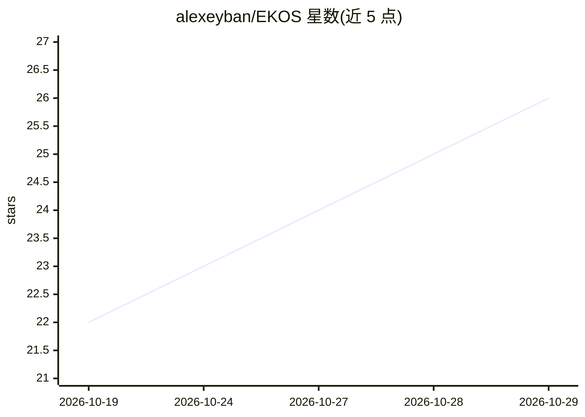

# alexeyban/EKOS

⭐ 26 · Rust · MIT · 推送 2026-10-26 · [GitHub](https://github.com/alexeyban/EKOS) · [官网](https://ekos.dev) · 个人维护

**把企业代码/SQL/文档编译为知识账本供 AI agent 查询的平台**

用 Rust 编写的开源企业知识层：观察源代码、Git 历史、SQL schema、GitHub issues/PRs、Confluence 与本地文档等既有系统，经确定性编译过程生成 Canonical Knowledge Model，存入仅追加、每条结论带证据的账本。AI agent（如 Claude Code）通过只读 MCP 服务器（ekos mcp serve）读取账本，不直接接触原始企业系统。提供 Linux/Windows/macOS 安装向导与预构建二进制，CLI/Web 控制台均可用；未观察到的系统默认脱敏。

## 筛选速览

| 维度 | 判定 | 备注 |
|---|---|---|
| AI 角色 | `ai-ecosystem` | LLM/agent 周边工具 |
| 许可风险 | `permissive` | MIT |
| 部署形态 | `desktop` | 安装包/桌面程序 |
| 模型依赖 | — | README 未给出锁定关系 |
| 硬件要求 | — | 无带数字的原话,不猜 |
| 安装摩擦 | `low` | 无编译、无系统依赖或容器化 |
| 成熟度 | — | 结构信号不足 |

## 能力要点

- 观察层只采集事实，编译过程确定且无副作用，产物内容寻址
- 账本仅追加，四类语义原语（Object/Relationship/Event/Evidence）均带证据
- AI agent 经只读 MCP 服务器查询，人力决策动作不可经 MCP 触达（有测试保障）
- 内置密钥/PII 脱敏基线且不可关闭；多种语言 AST 解析与二进制（.NET/JVM）连接器

## 适用场景

- 让 Claude Code 等 agent 基于带证据的知识账本回答企业代码库问题
- 把分散在 Git、SQL、Confluence、文档中的企业知识聚合为语义模型
- 以更少 token 消耗回答源码问题（基准宣称 67-93% 节省）
- 企业数据血缘与知识审计

## 场景标签

`知识图谱` · 领域:知识与检索

## 证据(README 行号)

> L8: EKOS is the open-source knowledge layer for AI agents: a compiler that turns source code, SQL,
> L24: agents (Claude Code among them) read that ledger through a read-only Model Context Protocol server

## 星数曲线

2026-10-19 22 → 2026-10-29 26（+4）

---
*卡片 v1 · prompt 1.4 · 生成 2026-10-27 · 置信度 mid · 依据 README sha `fb48564c12b1` · [字段定义](../../DATASET.md)*
