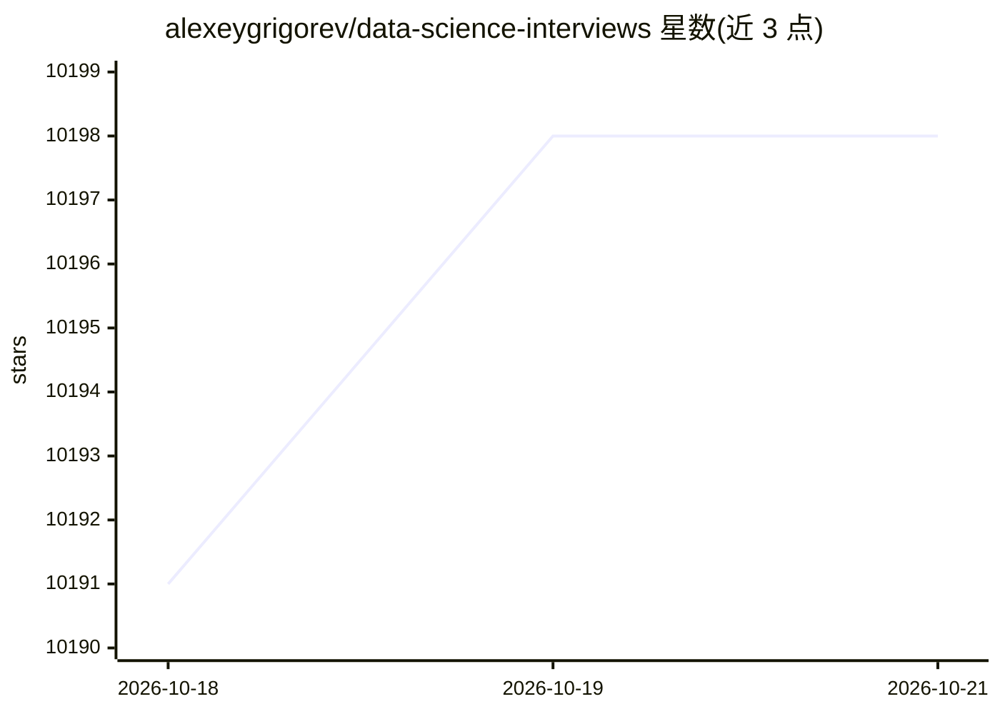

# alexeygrigorev/data-science-interviews

⭐ 10,198 · HTML · CC-BY-4.0 · 推送 2026-09-26 · [GitHub](https://github.com/alexeygrigorev/data-science-interviews) · [官网](https://alexeygrigorev.com/data-science-interviews/) · 个人维护

**数据科学面试问答社区合集：分类问题与社区答案**

收录数据科学面试问题及社区给出的答案的知识库仓库。问题按类别组织为理论题（线性模型、树、神经网络等，theory.md）、技术题（SQL、Python、编码，technical.md），并在 contrib 文件夹收录社区贡献的题目（如概率题）。答案由社区通过 PR 提供、改进与纠错，另维护 awesome.md 汇总其他面试资源，内容按 CC BY 4.0 许可发布，贡献者名单单独记录。

## 筛选速览

| 维度 | 判定 | 备注 |
|---|---|---|
| AI 角色 | `ai-knowledge` | 知识聚合/清单类 |
| 许可风险 | `viral` | CC-BY-4.0 |
| 部署形态 | `None` |  |
| 模型依赖 | — | README 未给出锁定关系 |
| 硬件要求 | — | 无带数字的原话,不猜 |
| 安装摩擦 | `low` | 无编译、无系统依赖或容器化 |
| 成熟度 | — | 结构信号不足 |

## 能力要点

- 理论题覆盖线性模型、树、神经网络等主题
- 技术题覆盖 SQL、Python 与编码
- 社区通过 PR 提交答案、改进与纠错
- awesome.md 汇总其他面试问题与资源

## 适用场景

- 准备数据科学岗位面试，按主题刷题看答案
- 查找理论与技术类常见面试题参考
- 贡献自己的答案或补充面试题

## 场景标签

`精选清单` · 领域:学习与行业

## 证据(README 行号)

> L8: Data science interview questions - with answers
> L22: * Theoretical questions: theory.md (linear models, trees, neural networks and others)
> L23: * Technical questions: technical.md (SQL, Python, coding)

## 星数曲线

2026-10-18 10,191 → 2026-10-21 10,198（+7）

---
*卡片 v1 · prompt 1.4 · 生成 2026-10-20 · 置信度 high · 依据 README sha `c36275b0ba0f` · [字段定义](../../DATASET.md)*
