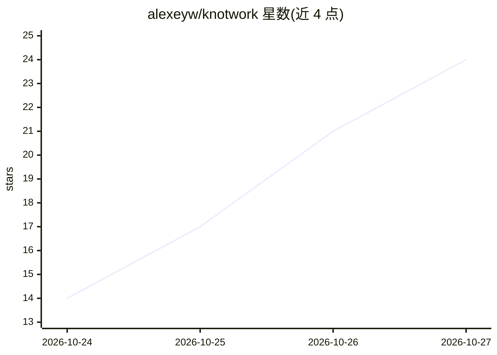

# alexeyw/knotwork

⭐ 24 · Kotlin · Apache-2.0 · 推送 2026-10-25 · [GitHub](https://github.com/alexeyw/knotwork) · 个人维护

**本地优先的 Android 端侧 AI agent 应用，自建管线**

Android 应用，通过 LiteRT-LM 在手机上运行语言模型，典型对话不离开设备。核心形态是可自行组装的管线：14 种节点类型（输入、端侧 LLM、可选云端 LLM、工具调用、路由、评估等），在应用内或单文件浏览器编辑器中编辑。支持 MCP 工具、内置工具与技能，敏感或破坏性调用默认暂停等待用户确认。云端提供商与自有服务器为可选并使用用户自己的 key。要求 Android 14+、约 2 GB 空闲 RAM。

## 筛选速览

| 维度 | 判定 | 备注 |
|---|---|---|
| AI 角色 | `ai-native` | 本体是模型或模型工具 |
| 许可风险 | `permissive` | Apache-2.0 |
| 部署形态 | `desktop` | 安装包/桌面程序 |
| 模型依赖 | local-ok | 支持本地模型 |
| 硬件要求 | `cpu-ok` | |
| 安装摩擦 | `medium` | 含编译或系统依赖之一 |
| 成熟度 | — | 结构信号不足 |

## 能力要点

- LiteRT-LM 端侧推理，云端（OpenAI/Anthropic/Gemini/DeepSeek 等）与自有服务器为可选
- 14 种节点类型的管线编辑器，应用内与离线单文件浏览器编辑器均可用
- MCP 工具调用、技能（指令+工具白名单），敏感调用默认等待确认
- 运行记录种子与模型 SHA-256，可验证、重跑或导出 trace；SQLCipher 加密数据库

## 适用场景

- 在手机上搭建自己的 agent 工作流，控制每一步对数据的处理
- 从任意应用分享内容，端侧模型整理为结构化笔记
- 接入自己的 Ollama/vLLM 服务器作为可选模型来源
- 通过触发器（时间/充电/Wi-Fi）自动运行管线

## 场景标签

`工作流自动化` `知识库管理` · 领域:效率与自动化

## 证据(README 行号)

> L20: Knotwork is an Android app that runs a language model on your phone and lets
> L22: **on-device** through LiteRT-LM (Google's
> L26: Every conversation goes through a pipeline — what Tasker, n8n or Zapier would

## 星数曲线

2026-10-24 14 → 2026-10-27 24（+10）

---
*卡片 v1 · prompt 1.4 · 生成 2026-10-27 · 置信度 high · 依据 README sha `da70e5605b03` · [字段定义](../../DATASET.md)*
