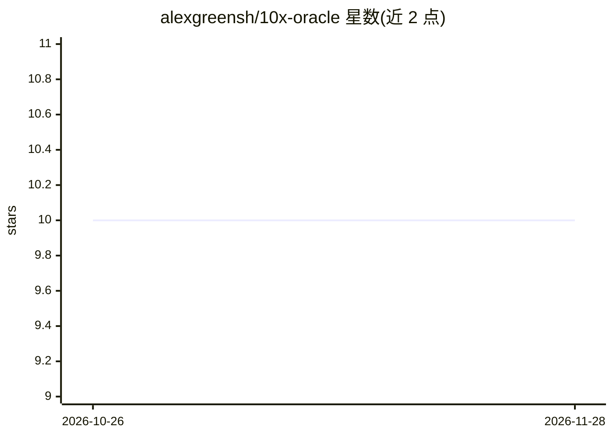

# alexgreensh/10x-oracle

⭐ 10 · Python · 推送 2026-08-03 · [GitHub](https://github.com/alexgreensh/10x-oracle) · [官网](the10xcompany.ai) · 组织维护

**让 AI 智能体检索 10x Marketers 社区 WhatsApp 历史并带引用作答**

面向 10x Marketers 社区成员的智能体插件：把群内数千条 WhatsApp 消息做成可检索的语料库，用户自己的智能体（Claude Code、Codex 等）提问时，插件负责检索匹配的真实消息并返回带姓名、日期的引用块，由智能体据此撰写回答；API 本身不生成文本。支持希伯来语与英语双语检索、时间线趋势追踪、争议双方呈现、每周摘要与 HTML 仪表盘生成。访问需通过 Google 登录并以手机号哈希核验成员身份，token 有效期 90 天。

## 筛选速览

| 维度 | 判定 | 备注 |
|---|---|---|
| AI 角色 | `ai-knowledge` | 知识聚合/清单类 |
| 许可风险 | `none` | — |
| 部署形态 | `None` |  |
| 模型依赖 | locked-api |  |
| 硬件要求 | — | 无带数字的原话,不猜 |
| 安装摩擦 | `low` | 无编译、无系统依赖或容器化 |
| 成熟度 | — | 结构信号不足 |

## 能力要点

- 只检索不生成：返回带姓名与日期的真实消息引用块
- 希伯来语+英语双语检索（社区约 83% 内容为希伯来语）
- 语料以 untrusted-data 围栏包装，防提示注入
- 限额 60 问/小时、300 问/天

## 适用场景

- 向自己常用的智能体提问，引用社区成员对某营销工具的真实讨论
- 追踪某工作流或方法论在社区内是升温还是被替代
- 生成社区每周讨论摘要与分享链接清单
- 对比 A 与 B 方案时查看社区双方观点及证据量

## 场景标签

`RAG` · 领域:知识与检索

## 证据(README 行号)

> L17: **The 10x Oracle is the group's memory, made askable.** You ask your own AI a question in plain language, about a t
> L21: This is the part that makes it trustworthy. The Oracle's API **never writes the answer** and never runs a model of 
> L87: The Oracle rides inside whatever AI you already use. It is **one plugin**, not three builds, so

## 星数曲线

2026-10-26 10 → 2026-11-28 10（+0）

---
*卡片 v1 · prompt 1.4 · 生成 2026-11-20 · 置信度 mid · 依据 README sha `349f1a67aa1f` · [字段定义](../../DATASET.md)*
