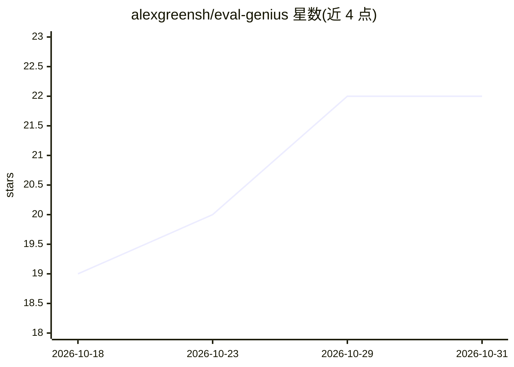

# alexgreensh/eval-genius

⭐ 22 · Python · Apache-2.0 · 推送 2026-09-21 · [GitHub](https://github.com/alexgreensh/eval-genius) · [官网](https://alexgreenshpun.com) · 个人维护 · 中文 README

**教 AI 编码 agent 何时需要评测、如何搭建与解读的技能包**

以 SKILL.md 形式分发的 agent 技能，附带九个标准库 Python 脚本：在用户构建 AI 系统的任意阶段介入，判断是否需要评测、从真实坏输出自底向上构造可测量类别、选择评分器与指标、搭建带 PASS/FAIL/CANNOT-MEASURE 三态门禁的评测管线，并用 Wilson 区间、配对 bootstrap、judge-human 一致性校验等脚本解读结果。工具无关，可运行于 Claude Code、Codex、Droid 或任何加载 SKILL.md 的 agent，也可独立从终端运行；自身附带 24 例评测套件。含 Jev 决策模型路由脚本（可选）。

## 筛选速览

| 维度 | 判定 | 备注 |
|---|---|---|
| AI 角色 | `ai-ecosystem` | LLM/agent 周边工具 |
| 许可风险 | `permissive` | Apache-2.0 |
| 部署形态 | `None` |  |
| 模型依赖 | locked-api |  |
| 硬件要求 | — | 无带数字的原话,不猜 |
| 安装摩擦 | `low` | 无编译、无系统依赖或容器化 |
| 成熟度 | — | 结构信号不足 |

## 能力要点

- 九个标准库 Python 脚本零依赖运行：门禁、置信区间、judge 校准等
- 支持自顶向下（先定义"好"）与自底向上（从坏输出出发）两种切入方式
- 门禁输出 PASS/FAIL/CANNOT-MEASURE 三态，崩溃不计为通过
- 含对抗测试（提示注入、不安全工具调用、数据外泄）分类型报告
- 自带 24 例评测套件用于验证技能触发与质量

## 适用场景

- 判断我的 prompt 改动或 agent 换框架是否真的变好
- 不知道测什么时，从真实坏输出出发构造评测
- 为发布声明产出带置信区间的数字
- 校准 LLM judge 与人工标注的一致性

## 场景标签

`模型评测` · 领域:评测与运维

## 证据(README 行号)

> L46: It is tool-agnostic and dependency-free: a `SKILL.md` plus a few standard-library Python scripts. It runs in Claude
> L137: Eval Genius is not an eval framework, and it does not want your runs. Whatever executes your evals, the plugin eva

## 星数曲线

2026-10-18 19 → 2026-10-31 22（+3）

---
*卡片 v1 · prompt 1.4 · 生成 2026-10-28 · 置信度 high · 依据 README sha `fc2b8a1f0d84` · [字段定义](../../DATASET.md)*
