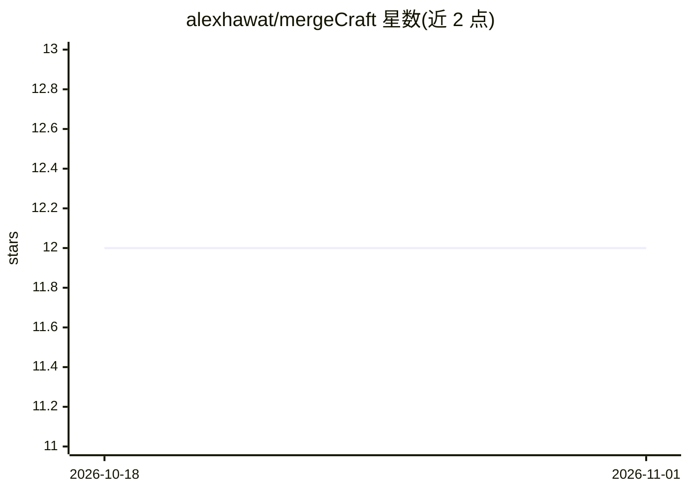

# alexhawat/mergeCraft

⭐ 12 · Python · MIT · 推送 2026-10-31 · [GitHub](https://github.com/alexhawat/mergeCraft) · [官网](https://github.com/alexhawat/mergeCraft#-get-started-in-3-steps) · 个人维护

**BYOK 自托管的 AI 代码审查引擎，以 GitHub Action 运行**

面向需要自主托管 PR 审查的团队与开发者的独立 GitHub Action：无 SaaS 账号，自带 API key 或 Claude Pro/Max、ChatGPT 订阅等凭证。审查流程为确定性分析器（actionlint、zizmor、ShellCheck、Hadolint 等）处理可机械验证的事实，LLM 审查代理判断其余问题，只读校验器对 Critical/Major 发现进行二次复核后输出类型化结论，驱动行内评论与 mergecraft-approval 结构化门禁。支持信任分级、模型回退链、本地 diff 离线审查、MCP 服务与 SARIF 上传。MIT 许可，经 uv 安装 CLI 或纯 Docker 使用。

## 筛选速览

| 维度 | 判定 | 备注 |
|---|---|---|
| AI 角色 | `ai-native` | 本体是模型或模型工具 |
| 许可风险 | `permissive` | MIT |
| 部署形态 | `None` |  |
| 模型依赖 | locked-api |  |
| 硬件要求 | — | 无带数字的原话,不猜 |
| 安装摩擦 | `low` | 无编译、无系统依赖或容器化 |
| 成熟度 | — | 结构信号不足 |

## 能力要点

- 确定性分析器 + LLM 审查代理 + 只读校验器的三段式流水线
- BYOK：凭证与代码留在 GitHub Actions 与本仓库，无专有后端
- mergecraft-approval 审批门禁是类型化发现的纯函数
- 本地 diff 离线审查、--agent JSONL 协议、MCP 服务、契约化退出码

## 适用场景

- 在 GitHub Actions 中对每个 PR 自动做 AI 代码审查并拦截高风险合并
- 不依赖 SaaS、自带模型订阅完成仓库内的代码审查
- 在本地 diff 或 worktree 上离线跑同一套审查流水线
- 通过 JSONL 事件流或 MCP 把审查接入自己的编排系统

## 场景标签

`代码审查` · 领域:编码与开发

## 证据(README 行号)

> L5: **AI-powered PR review as a standalone, BYOK GitHub Action.**
> L189: then a **review agent** and a read-only **verifier** produce **typed findings**
> L245: mergecraft provider auth anthropic --scope github   # Claude Pro/Max

## 星数曲线

2026-10-18 12 → 2026-11-01 12（+0）

---
*卡片 v1 · prompt 1.4 · 生成 2026-11-01 · 置信度 high · 依据 README sha `3fb8dce99e61` · [字段定义](../../DATASET.md)*
