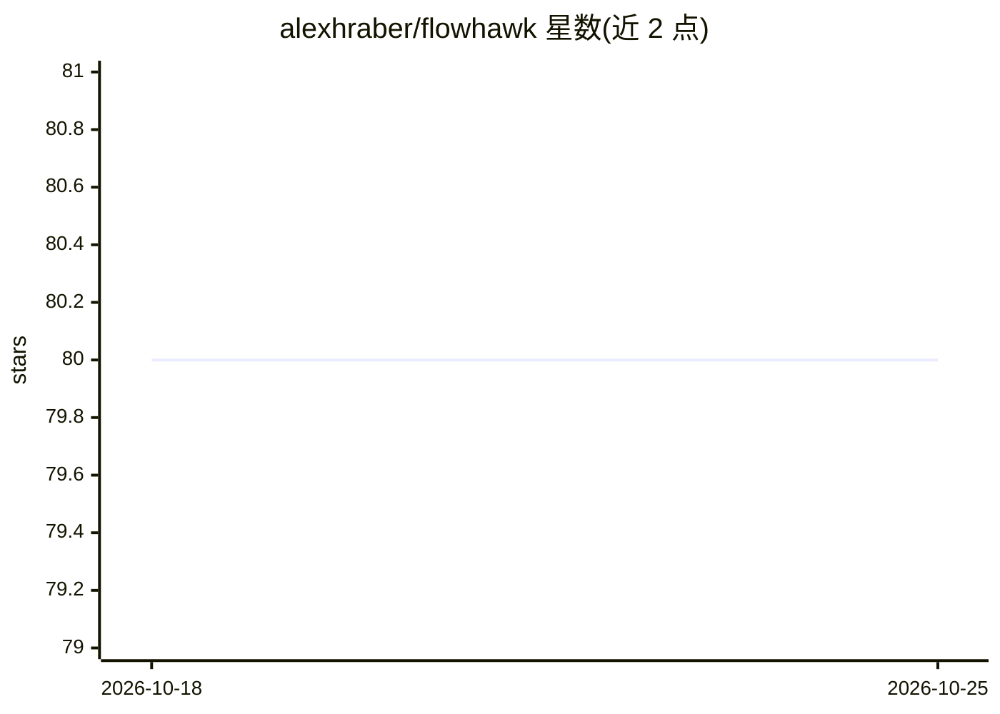

# alexhraber/flowhawk

⭐ 80 · Go · MIT · 推送 2026-07-14 · [GitHub](https://github.com/alexhraber/flowhawk) · 个人维护

**eBPF 网络安全监控平台：实时检测端口扫描、DDoS 等威胁**

基于 eBPF/XDP 的开源网络安全监控平台，在内核态做零拷贝包处理，提供端口扫描、DDoS、僵尸网络 C2、数据渗出等威胁检测，采用规则引擎加机器学习双引擎与实时异常评分。提供 Web 仪表盘（8080 端口）展示实时威胁流、流量分析与历史时间线。以 Docker 镜像部署为主，分安全训练模式（模拟数据、无特权）与真实 Hunt 模式（需 privileged 容器，README 详细列出内核级访问等安全风险）；也可用 Go 1.23+ 从源码构建，需 Linux 4.15+ 等具备 eBPF 能力的内核。

## 筛选速览

| 维度 | 判定 | 备注 |
|---|---|---|
| AI 角色 | `ai-enhanced` | 去掉 AI 部分产品仍成立 |
| 许可风险 | `permissive` | MIT |
| 部署形态 | `self-host` | docker 或自建部署 |
| 模型依赖 | — | README 未给出锁定关系 |
| 硬件要求 | — | 无带数字的原话,不猜 |
| 安装摩擦 | `low` | 无编译、无系统依赖或容器化 |
| 成熟度 | — | 结构信号不足 |

## 能力要点

- eBPF/XDP 内核态包处理，声明 10M+ PPS、亚微秒延迟
- 规则引擎 + 机器学习的多引擎威胁检测与实时异常评分
- 检测端口扫描（快速/隐蔽/水平）、DDoS、C2 信标、数据渗出
- Docker 双模式部署：无特权训练模式与真实监控 Hunt 模式

## 适用场景

- 对关键基础设施网络做实时威胁检测与告警
- 在仪表盘中查看实时威胁流、流量模式与攻击历史
- 以安全隔离的训练模式先体验与测试平台功能

## 场景标签

`网络安全` · 领域:学习与行业

## 证据(README 行号)

> L15: **FlowHawk** is a **modern open-source eBPF-powered Network Security Monitoring Platform** engineered for mission-c
> L43: - **Multi-engine threat detection** (rule-based + ML)

## 星数曲线

2026-10-18 80 → 2026-10-25 80（+0）

---
*卡片 v1 · prompt 1.4 · 生成 2026-10-24 · 置信度 high · 依据 README sha `26325847fab4` · [字段定义](../../DATASET.md)*
