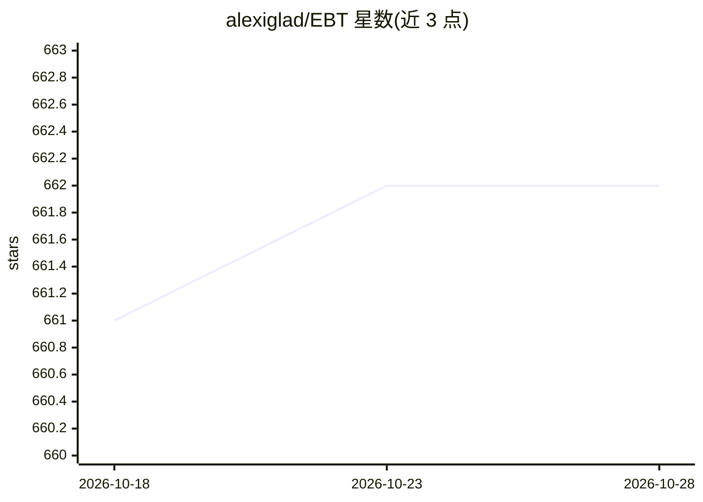

# alexiglad/EBT

⭐ 662 · Python · Apache-2.0 · 推送 2026-04-21 · [GitHub](https://github.com/alexiglad/EBT) · [官网](https://energy-based-transformers.github.io/) · 个人维护

**Energy-Based Transformers 论文的 PyTorch 官方代码**

论文《Energy-Based Transformers are Scalable Learners and Thinkers》的 PyTorch 训练与推理代码库。EBT 是一种新的模型架构，支持 generalizable reasoning / System 2 Thinking，可对每个 token 的预测进行思考式计算。仓库基于 PyTorch Lightning 构建，提供 NLP、图像、视频等多模态的预训练与推理 job 脚本，支持 slurm 多机多卡，需要 wandb 登录、HF token 与 FFPROBE（视频数据集）。另含最小化训练循环示例与机器人策略扩展 EBT-Policy 的链接。面向复现论文或训练自有 EBT 模型的研究者与开发者。

## 筛选速览

| 维度 | 判定 | 备注 |
|---|---|---|
| AI 角色 | `ai-native` | 本体是模型或模型工具 |
| 许可风险 | `permissive` | Apache-2.0 |
| 部署形态 | `library` | 以包/库形式分发 |
| 模型依赖 | — | README 未给出锁定关系 |
| 硬件要求 | — | 无带数字的原话,不猜 |
| 安装摩擦 | `low` | 无编译、无系统依赖或容器化 |
| 成熟度 | — | 结构信号不足 |

## 能力要点

- EBT 模型架构的 PyTorch 实现与预训练/推理脚本
- 支持 NLP、图像、视频等多模态任务
- 基于 PyTorch Lightning，支持 slurm 分布式训练
- 提供 System 2 Thinking 自验证式推理（infer_generated_samples / infer_ebt_advanced）

## 适用场景

- 复现 EBT 论文的训练与推理实验
- 基于 EBT 架构训练自己的语言或图像模型
- 研究 System 2 Thinking 式的自验证推理方法

## 场景标签

`模型训练` `多模态` · 领域:感知与多模态

## 证据(README 行号)

> L1: # ⚡️🧠🤖 Energy-Based Transformers are Scalable Learners and Thinkers
> L7: Energy-Based Transformers (EBTs) are a new approach enabling **generalizable** reasoning/System 2 Thinking on any pr
> L63: ### Energy-Based Transformers Pretraining

## 星数曲线

2026-10-18 661 → 2026-10-28 662（+1）

---
*卡片 v1 · prompt 1.4 · 生成 2026-10-21 · 置信度 mid · 依据 README sha `0b9fc8ba8be7` · [字段定义](../../DATASET.md)*
