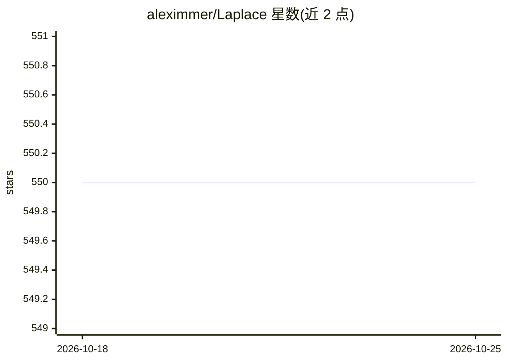

# aleximmer/Laplace

⭐ 550 · Python · MIT · 推送 2026-10-24 · [GitHub](https://github.com/aleximmer/Laplace) · [官网](https://aleximmer.github.io/Laplace) · 组织维护

**PyTorch 神经网络拉普拉斯近似库：贝叶斯后验与不确定性量化**

laplace-torch 是面向深度学习研究者的 Python 库，对整个神经网络、子网络或仅最后一层应用拉普拉斯近似，提供后验近似、边际似然估计与多种后验预测计算，并含 ELLA/VaLLA 函数空间估计器。配套论文 Laplace Redux 介绍方法并附实验复现代码。README 明确提示需自行调整 Hessian 分解、先验精度调优、预测方法与后端等选项，并非开箱即用。

## 筛选速览

| 维度 | 判定 | 备注 |
|---|---|---|
| AI 角色 | `ai-native` | 本体是模型或模型工具 |
| 许可风险 | `permissive` | MIT |
| 部署形态 | `library` | 以包/库形式分发 |
| 模型依赖 | — | README 未给出锁定关系 |
| 硬件要求 | — | 无带数字的原话,不猜 |
| 安装摩擦 | `low` | 无编译、无系统依赖或容器化 |
| 成熟度 | — | 结构信号不足 |

## 能力要点

- 支持全网络/子网络/仅最后一层的拉普拉斯近似
- 后验近似、边际似然估计与多种后验预测计算
- 函数空间估计器 ELLA（Nyström）与 VaLLA（变分）
- 可复现论文实验代码，覆盖不确定性量化、模型选择、持续学习

## 适用场景

- 为已训练神经网络做预测不确定性量化
- 神经网络模型选择（边际似然估计）
- 持续学习场景中的贝叶斯化处理

## 场景标签

 · 领域:机器学习/贝叶斯推断

## 证据(README 行号)

> L9: The laplace package facilitates the application of Laplace approximations for entire neural networks, subnetworks of
> L10: The package enables posterior approximations, marginal-likelihood estimation, and various posterior predictive comp

## 星数曲线

2026-10-18 550 → 2026-10-25 550（+0）

---
*卡片 v1 · prompt 1.4 · 生成 2026-10-21 · 置信度 high · 依据 README sha `6fea480d5660` · [字段定义](../../DATASET.md)*
