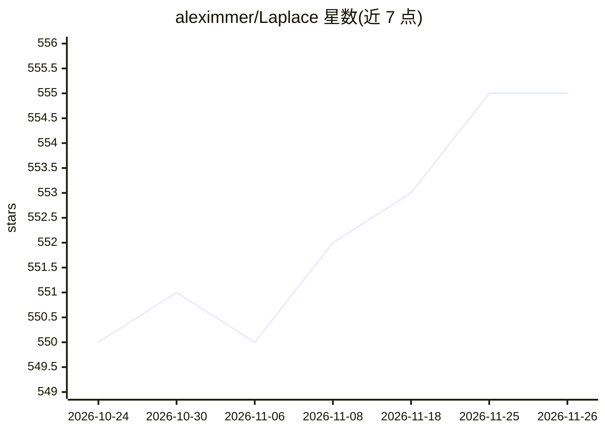

# aleximmer/Laplace

⭐ 555 · Python · MIT · 推送 2026-11-12 · [GitHub](https://github.com/aleximmer/Laplace) · [官网](https://aleximmer.github.io/Laplace)

**为深度学习研究者提供神经网络拉普拉斯近似库**

面向神经网络全参数、子网络或仅最后一层的拉普拉斯近似 Python 库，提供后验近似、边际似然估计及多种后验预测计算，支持权重空间与函数空间两种近似方式。配套论文《Laplace Redux》介绍方法并在不确定性量化、模型选择与持续学习等任务中给出实验复现代码。README 提示用户需自行尝试不同配置选项（Hessian 分解、先验精度调优方法、预测方法、backend 等），并参考相关论文按应用场景设置。默认安装 Curvlinops 后端，ASDL 与 BackPACK 为可选扩展。

## 筛选速览

| 维度 | 判定 | 备注 |
|---|---|---|
| AI 角色 | `ai-native` | 本体是模型或模型工具 |
| 许可风险 | `permissive` | MIT |
| 部署形态 | `library` | 以包/库形式分发 |
| 模型依赖 | — | README 未给出锁定关系 |
| 硬件要求 | — | 无带数字的原话,不猜 |
| 安装摩擦 | `low` | 无编译、无系统依赖或容器化 |
| 成熟度 | — | 结构信号不足 |

## 能力要点

- 支持全网络、子网络、最后一层的拉普拉斯近似
- 提供权重空间与函数空间两种近似方式
- 支持后验近似、边际似然估计与后验预测计算
- 提供 Curvlinops（默认）、ASDL、BackPACK 等可选后端

## 适用场景

- 对预训练神经网络做预测不确定性量化
- 贝叶斯深度学习研究中的模型选择
- 持续学习实验的方法实现

## 场景标签

## 证据(README 行号)

> L9: The `laplace` package facilitates the application of Laplace approximations for entire neural networks, subnetworks 
> L10: The package enables posterior approximations, marginal-likelihood estimation, and various posterior predictive comp
> L13: There is also a corresponding paper, _Laplace Redux — Effortless Bayesian Deep Learning_, which introduces the libr

## 星数曲线

2026-10-24 550 → 2026-11-26 555（+5）

---
*卡片 v1 · prompt 1.4 · 生成 2026-11-25 · 置信度 high · 依据 README sha `61411ba5f7ae` · [字段定义](../../DATASET.md)*
