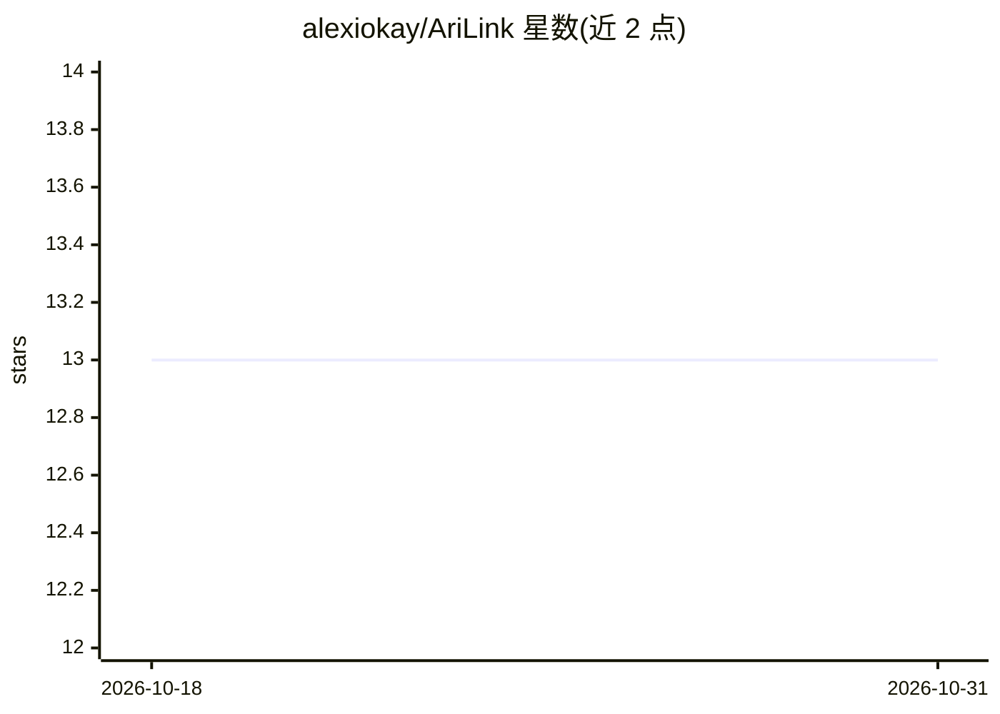

# alexiokay/AriLink

⭐ 13 · TypeScript · NOASSERTION · 推送 2026-03-10 · [GitHub](https://github.com/alexiokay/AriLink) · 个人维护

**基于 Asterisk ARI 的电话平台：语音助手、实时转写与外呼管理**

构建在 Asterisk ARI 之上的电话通信平台，由 Nuxt 4 Web 管理面板、Rust RTP 音频管道和本地 AI 服务组成。支持流式 LLM 语音对话（逐句 TTS、Barge-In 插话打断）、可插拔的呼叫逻辑（LLM 对话/IVR 转接/直拨/OpenClaw）、本地 TTS（Kokoro 82M）与多后端 STT（Parakeet TDT/Whisper/Google Cloud，带自动故障转移），并提供外呼活动引擎、SQLite 呼叫记录、内置软电话与 SSH 终端。推荐 Docker Compose 一键部署，也可对接已有 FreePBX 手动安装；作者声明项目处于重度开发阶段。

## 筛选速览

| 维度 | 判定 | 备注 |
|---|---|---|
| AI 角色 | `ai-enhanced` | 去掉 AI 部分产品仍成立 |
| 许可风险 | `none` | NOASSERTION |
| 部署形态 | `self-host` | docker 或自建部署 |
| 模型依赖 | — | README 未给出锁定关系 |
| 硬件要求 | — | 无带数字的原话,不猜 |
| 安装摩擦 | `low` | 无编译、无系统依赖或容器化 |
| 成熟度 | — | 结构信号不足 |

## 能力要点

- 流式 LLM 语音助手：逐句 TTS、AEC3 回声消除 + Silero VAD 支持插话打断
- 可插拔 Brains：LLM 对话 / IVR 转接 / 直拨 / OpenClaw，经 config.json 切换
- 本地 STT 多后端链（Parakeet TDT / Whisper / Google Cloud）自动故障转移，本地 TTS 用 Kokoro 82M
- Docker Compose 部署 4 服务（Asterisk/Parakeet/Kokoro/AriLink），附 arilink CLI

## 适用场景

- 搭建能对话的 AI 电话客服或语音 IVR
- 管理外呼活动：上传名单、配置并发与呼叫脚本
- 在 Web 面板中统一管理 PBX、通话记录与转写回放

## 场景标签

`语音 Agent` · 领域:对话与助手

## 证据(README 行号)

> L15: AriLink is a telephony platform built on Asterisk's ARI (Asterisk REST Interface). It combines a **Nuxt 4 web dashb
> L21: - **LLM Voice Agent** - Full conversational AI via LlmChatBrain — streaming LLM responses with sentence-by-sentence

## 星数曲线

2026-10-18 13 → 2026-10-31 13（+0）

---
*卡片 v1 · prompt 1.4 · 生成 2026-10-31 · 置信度 low · 依据 README sha `ea66affd3e02` · [字段定义](../../DATASET.md)*
