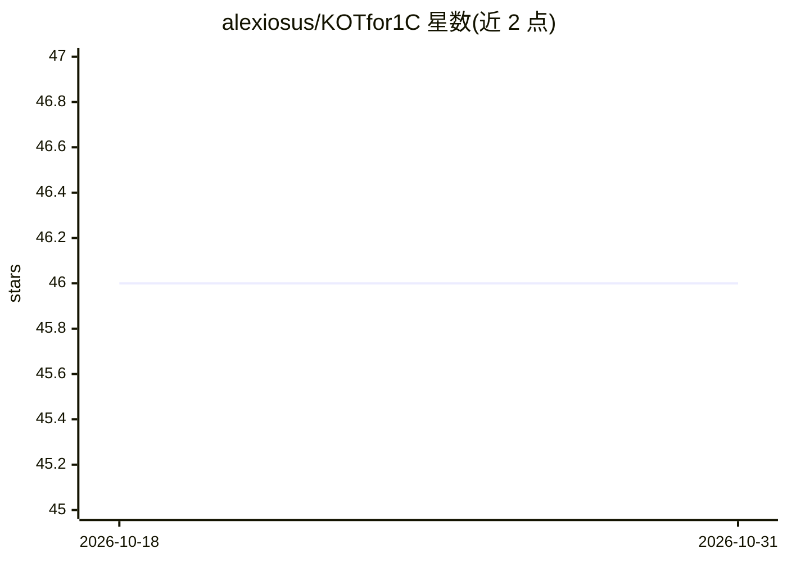

# alexiosus/KOTfor1C

⭐ 46 · TypeScript · MIT · 推送 2026-10-30 · [GitHub](https://github.com/alexiosus/KOTfor1C) · [官网](https://marketplace.visualstudio.com/items?itemName=AlexeyEremeev.kot-test-toolkit) · 个人维护

**1C 自动化测试的 VS Code 扩展，含 AI 辅助功能**

面向 1C 平台 QA 与自动化测试工程师的 VS Code 扩展：以 YAML 格式编写 Gherkin 场景，提供 IntelliSense、诊断与 quick fix、场景树管理、通过 Vanessa Automation 构建与运行测试、信息库管理、表单探索器与参数管理。AI 功能包括生成场景描述、按 git diff 生成 AI 报告、AI 评审变更测试，支持 LM Studio、Ollama、OpenAI 等提供方。限制：构建需 СППР 处理、运行需 Vanessa Automation、仅在 Windows 完整验证，Form Explorer 为 beta。

## 筛选速览

| 维度 | 判定 | 备注 |
|---|---|---|
| AI 角色 | `ai-enhanced` | 去掉 AI 部分产品仍成立 |
| 许可风险 | `permissive` | MIT |
| 部署形态 | `None` |  |
| 模型依赖 | local-ok | 支持本地模型 |
| 硬件要求 | — | 无带数字的原话,不猜 |
| 安装摩擦 | `low` | 无编译、无系统依赖或容器化 |
| 成熟度 | `idea` | |

## 能力要点

- Gherkin 场景编辑器：IntelliSense、诊断、quick fix、语义搜索
- 在 VS Code 内构建并通过 Vanessa Automation 运行测试，含实时步骤高亮
- AI 工具：场景描述生成、git diff 报告、变更测试 AI 评审
- 信息库管理与表单探索器（beta），无需在测试库安装运行时扩展

## 适用场景

- 在 VS Code 中编写和调试 1C YAML 自动化测试
- 从测试管理器一键准备测试库并运行 Vanessa Automation
- 用 AI 生成测试描述并评审变更测试的覆盖情况

## 场景标签

`代码审查` · 领域:编码与开发

## 证据(README 行号)

> L3: **KOT** (_**K**eep **O**n **T**esting_) **for 1C** — расширение VS Code для разработки и поддержки автотестов 1С в Y
> L26: - Генерация описания сценария в `KOTМетаданные.Описание` — что проверяется, какой бизнес-процесс, какие развилки.
> L29: - Поддержка LM Studio, Ollama, OpenAI, Gemini, Azure и любого совместимого OpenAI-провайдера.

## 星数曲线

2026-10-18 46 → 2026-10-31 46（+0）

---
*卡片 v1 · prompt 1.4 · 生成 2026-10-25 · 置信度 high · 依据 README sha `cb164c12329a` · [字段定义](../../DATASET.md)*
