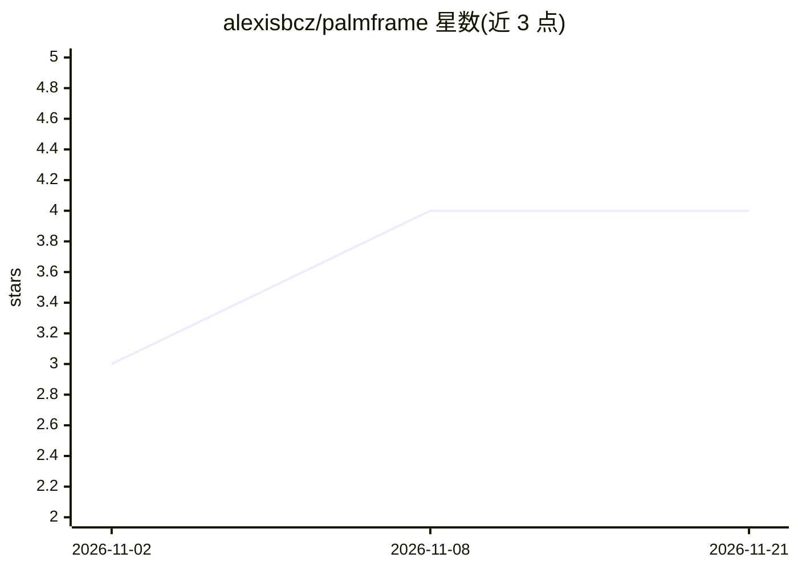

# alexisbcz/palmframe

⭐ 4 · TypeScript · MIT · 推送 2026-11-08 · [GitHub](https://github.com/alexisbcz/palmframe) · [官网](https://www.palmframe.com) · 个人维护

**给漫画作者用 AI 生成角色一致的分镜并一键导出 Instagram 轮播**

开源 Web 漫画编辑器（React Router + Supabase），自称是 Anifusion 的开源替代品。核心机制：从模型图（model sheets）出发保持角色跨分格一致，支持逐格编辑提示词与 AI 修图，画布将项目保存为 JSON 并存入 Supabase。附加功能：3D 布景渲染成面板图像或发给 FLUX.2 Klein 作引导、浏览器端本地模型工具（7 个 Labs 小应用）、通过 Zernio 发布 Instagram 轮播/Stories、将漫画转动画集、以及 Studio/Newsroom 的深度研究与内容产出。开发用 Bun，部署在 Vercel，部分功能需 OpenRouter 等第三方 API key。

## 筛选速览

| 维度 | 判定 | 备注 |
|---|---|---|
| AI 角色 | `ai-native` | 本体是模型或模型工具 |
| 许可风险 | `permissive` | MIT |
| 部署形态 | `None` |  |
| 模型依赖 | locked-api |  |
| 硬件要求 | — | 无带数字的原话,不猜 |
| 安装摩擦 | `medium` | 含编译或系统依赖之一 |
| 成熟度 | — | 结构信号不足 |

## 能力要点

- 基于模型图保持角色分格间一致，支持逐格提示词编辑
- 3D 布景（VRoid/GLB 模型）渲染为面板图像或线稿引导 AI 重绘
- 7 个浏览器端本地模型小应用，文件不上传服务器
- 漫画转动画集：视觉/图像/视频/语音模型经 OpenRouter 串联

## 适用场景

- 制作角色一致的连载漫画或条漫
- 一键生成并发布 Instagram 轮播/Stories
- 将已有漫画（CBZ/PDF）转为动画剧集
- 基于选题生成博客、社媒帖与新闻简报

## 场景标签

`图像生成` `视频生成` · 领域:内容生成

## 证据(README 行号)

> L3: Palmframe is an open-source alternative to Anifusion for making comics with AI.
> L164: 1. A vision model reads the panels and writes the shots, cast and spoken lines.
> L171: Everything runs on the person's connected OpenRouter account, so the feature

## 星数曲线

2026-11-02 3 → 2026-11-21 4（+1）

---
*卡片 v1 · prompt 1.4 · 生成 2026-11-21 · 置信度 high · 依据 README sha `20c2009cc7b4` · [字段定义](../../DATASET.md)*
