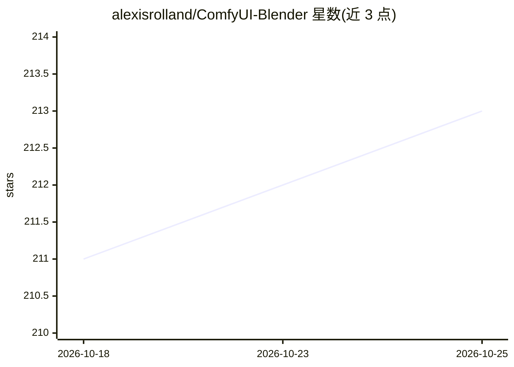

# alexisrolland/ComfyUI-Blender

⭐ 213 · Python · GPL-3.0 · 推送 2026-08-21 · [GitHub](https://github.com/alexisrolland/ComfyUI-Blender) · 个人维护

**Blender 插件+ComfyUI 自定义节点：在 Blender 内运行 ComfyUI 工作流**

包含两部分：安装在 ComfyUI 服务端的自定义节点，以及安装在 Blender 中的插件。用户在 ComfyUI 中用 Blender 节点搭建工作流并以 API 格式导出，再导入 Blender 插件；插件根据工作流的输入输出节点自动生成 UI，填写参数后发送到 ComfyUI 服务器执行。要求较新版本的 ComfyUI（v0.3.75 对应 custom node schema v3）与 Blender v4.5+/v5.0。节点可经 ComfyUI-Manager 安装或克隆本仓库；Blender 插件从 Release 下载 zip 安装。

## 筛选速览

| 维度 | 判定 | 备注 |
|---|---|---|
| AI 角色 | `ai-ecosystem` | LLM/agent 周边工具 |
| 许可风险 | `viral` | GPL-3.0 |
| 部署形态 | `desktop` | 安装包/桌面程序 |
| 模型依赖 | — | README 未给出锁定关系 |
| 硬件要求 | — | 无带数字的原话,不猜 |
| 安装摩擦 | `low` | 无编译、无系统依赖或容器化 |
| 成熟度 | — | 结构信号不足 |

## 能力要点

- ComfyUI 服务端自定义节点 + Blender 插件两部分组成
- 根据工作流输入输出节点自动生成 Blender 侧 UI
- 以 API 格式导入/导出工作流并在 Blender 内运行
- 支持 ComfyUI 服务器与 Blender 客户端分机部署（--listen）

## 适用场景

- 在 Blender 中直接调用 ComfyUI 工作流生成图像素材
- 将 Blender 数据作为输入接入 ComfyUI 节点式生成流程
- 远程 ComfyUI 服务器的 Blender 客户端使用

## 场景标签

`图像生成` · 领域:内容生成

## 证据(README 行号)

> L6: This respository contains both custom nodes to be installed on the ComfyUI server and the Blender add-on to send wor
> L13: The Blender add-on UI is automatically composed according to the input and output nodes used in the workflow.

## 星数曲线

2026-10-18 211 → 2026-10-25 213（+2）

---
*卡片 v1 · prompt 1.4 · 生成 2026-10-22 · 置信度 high · 依据 README sha `4bca8c162480` · [字段定义](../../DATASET.md)*
