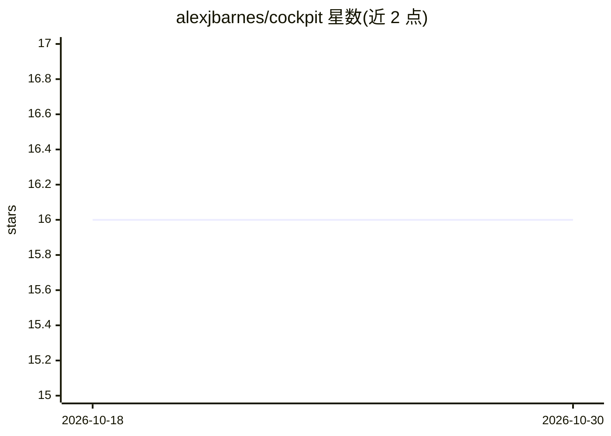

# alexjbarnes/cockpit

⭐ 16 · TypeScript · Apache-2.0 · 推送 2026-10-29 · [GitHub](https://github.com/alexjbarnes/cockpit) · 个人维护

**Claude Code 的 Web UI：多会话、定时任务与多模型接入**

在服务器上驱动真实 Claude Code CLI 的 Web 界面：支持并行多会话、PTY/无头两种运行模式、会话内切换模型（Anthropic、OpenRouter、DeepSeek、Groq、Gemini 等）、定时无人值守任务、PR 审查、Git 操作与问题看板，结果通过 Telegram/ntfy/Web 推送到手机。面向已安装 Claude Code CLI 与 Node.js 的开发者，在自有设备上自托管运行，Linux/macOS 已测试，Windows 未验证。Insights 与问题跟踪功能默认关闭且标注为实验性。

## 筛选速览

| 维度 | 判定 | 备注 |
|---|---|---|
| AI 角色 | `ai-ecosystem` | LLM/agent 周边工具 |
| 许可风险 | `permissive` | Apache-2.0 |
| 部署形态 | `library` | 以包/库形式分发 |
| 模型依赖 | locked-api |  |
| 硬件要求 | — | 无带数字的原话,不猜 |
| 安装摩擦 | `low` | 无编译、无系统依赖或容器化 |
| 成熟度 | `idea` | |

## 能力要点

- 以 Stream（无头）或 PTY 模式驱动真实 Claude Code CLI
- 支持会话内切换多种模型（OpenRouter、DeepSeek、Groq、Gemini、NVIDIA NIM 及 Anthropic 兼容端点）
- 定时/事件触发任务，可配置模型、工具、MCP 服务器与时间预算
- 通过 Telegram、ntfy 或 Web 推送将任务结果发送到手机

## 适用场景

- 在手机或任意设备上继续桌面端的 Claude Code 会话
- 安排无人值守的定时 Claude Code 任务并接收通知
- 以对话加并排 diff 的方式做 PR 审查

## 场景标签

`编码 Agent` `代码审查` · 领域:编码与开发

## 证据(README 行号)

> L3:  A web UI for Claude Code that frees it from your terminal.
> L12: - **The real CLI.** Not a reimplementation. Cockpit drives Claude Code itself, headless (Stream) or in a pseudo-ter
> L14: - **Any model.** Claude, or any model on OpenRouter (free ones included), OpenCode Zen and Go, DeepSeek, Groq, Gemi

## 星数曲线

2026-10-18 16 → 2026-10-30 16（+0）

---
*卡片 v1 · prompt 1.4 · 生成 2026-10-30 · 置信度 high · 依据 README sha `ffd0ccce3708` · [字段定义](../../DATASET.md)*
