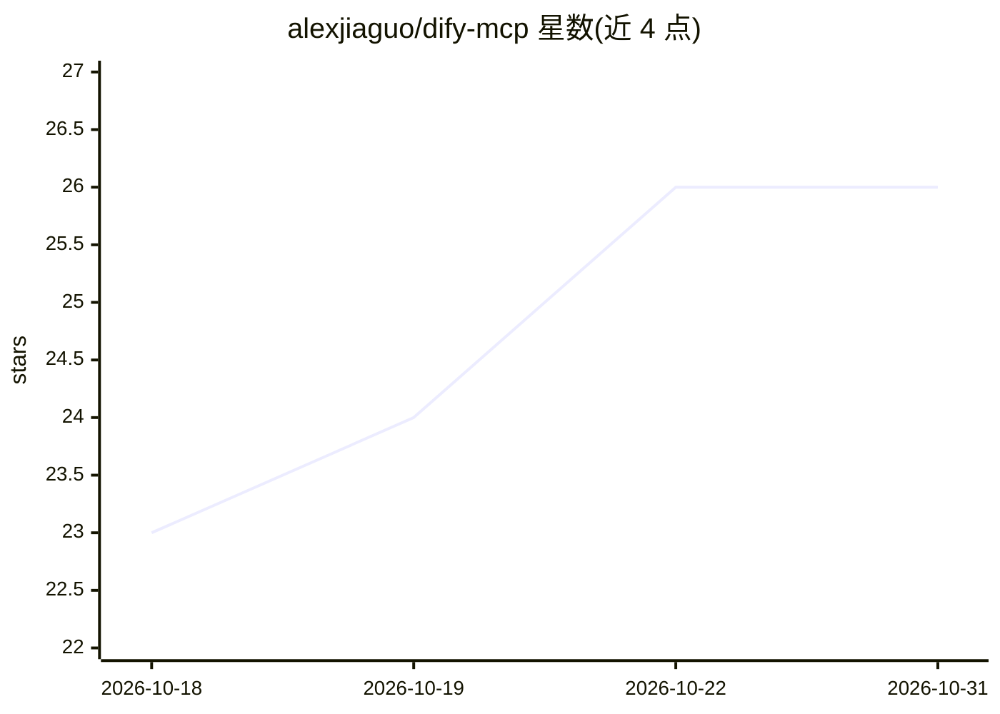

# alexjiaguo/dify-mcp

⭐ 26 · TypeScript · Apache-2.0 · 推送 2026-10-23 · [GitHub](https://github.com/alexjiaguo/dify-mcp) · [官网](https://github.com/alexjiaguo/dify-mcp) · 个人维护

**让任意 AI agent 自动构建/测试/发布 Dify 工作流的 MCP 服务器与 CLI**

将 Dify 控制台 API（含 Web UI 所用内部接口）封装为 192 个工具、21 个命名空间的统一注册表，提供两种使用面：可供任意 shell agent 调用的 CLI（difywf）和供 MCP 宿主接入的 MCP 服务器（stdio 或 Streamable HTTP），声称兼容 24 种主流 agent。处理 Dify 控制台的 cookie+CSRF 认证并自动刷新会话；破坏性操作需显式 confirm，变更带审计日志，图结构在同步前离线校验。支持 Dify 1.16.x/1.17.x，旧版不支持。零构建步骤，Node >= 23.6 直接运行原生 TypeScript。

## 筛选速览

| 维度 | 判定 | 备注 |
|---|---|---|
| AI 角色 | `ai-ecosystem` | LLM/agent 周边工具 |
| 许可风险 | `permissive` | Apache-2.0 |
| 部署形态 | `self-host` | docker 或自建部署 |
| 模型依赖 | — | README 未给出锁定关系 |
| 硬件要求 | — | 无带数字的原话,不猜 |
| 安装摩擦 | `low` | 无编译、无系统依赖或容器化 |
| 成熟度 | — | 结构信号不足 |

## 能力要点

- 192 个工具覆盖 Dify 控制台 API：建应用、编排工作流节点、测试、发布、版本与插件管理
- CLI 与 MCP 服务器双表面，同一 JSON 契约
- cookie+CSRF 会话捕获、存储（macOS keychain）与自动刷新
- 破坏性操作 confirm 门控、审计日志、--dry-run 与离线图校验

## 适用场景

- 让 Claude Code/Cursor 等 agent 以对话方式在 Dify 上搭建和调试工作流
- Dify 应用的 DSL 批量备份与跨实例迁移
- 通过脚本自动化 Dify 工作流的创建、测试与发布流程

## 场景标签

`工作流自动化` · 领域:效率与自动化

## 证据(README 行号)

> L23: **dify-mcp** is the bridge. It exposes the **entire Dify console API** as a unified
> L24: tool registry with **two surfaces**: a CLI any shell-capable agent can drive, and an
> L25: MCP server (stdio or Streamable HTTP) any MCP-compatible host can attach. Same 192 tools, same JSON

## 星数曲线

2026-10-18 23 → 2026-10-31 26（+3）

---
*卡片 v1 · prompt 1.4 · 生成 2026-10-26 · 置信度 high · 依据 README sha `6d15a086e7a1` · [字段定义](../../DATASET.md)*
