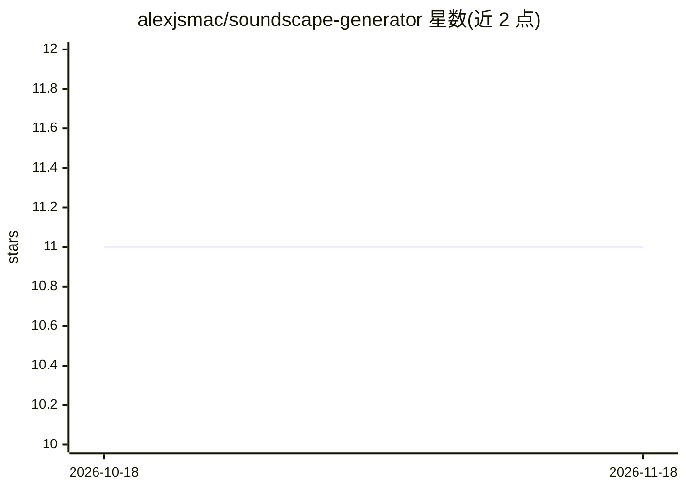

# alexjsmac/soundscape-generator

⭐ 11 · JavaScript · 推送 2026-10-26 · [GitHub](https://github.com/alexjsmac/soundscape-generator) · [官网](https://soundscape-generator-prod-499357478113.herokuapp.com/) · 个人维护

**从图片/视频生成环境音景的 Flask 网页应用**

Flask 网页应用：用 Amazon Rekognition 扫描图片与视频，获取媒体资产的标签列表，再以这些标签查询声音库，取回一组音频片段，拼接成媒体资产的音频背景。本地部署需配置 AWS 凭证，通过 Python 虚拟环境与 pip 安装依赖，再以 npm 命令构建并启动服务器，浏览器访问本地地址使用。

## 筛选速览

| 维度 | 判定 | 备注 |
|---|---|---|
| AI 角色 | `ai-native` | 本体是模型或模型工具 |
| 许可风险 | `none` | — |
| 部署形态 | `library` | 以包/库形式分发 |
| 模型依赖 | — | README 未给出锁定关系 |
| 硬件要求 | — | 无带数字的原话,不猜 |
| 安装摩擦 | `low` | 无编译、无系统依赖或容器化 |
| 成熟度 | — | 结构信号不足 |

## 能力要点

- 调用 Amazon Rekognition 识别图片/视频的标签
- 以标签查询声音库取回音频片段生成音景
- 以 Flask 网页应用形式本地运行

## 适用场景

- 为图片或视频自动配上匹配的环境背景音
- 生成基于媒体内容标签的音景素材

## 场景标签

 · 领域:多媒体/AI 应用

## 证据(README 行号)

> L3: This project provides a web application for scanning images and videos with Amazon Rekognition to retrieve a list of

## 星数曲线

2026-10-18 11 → 2026-11-18 11（+0）

---
*卡片 v1 · prompt 1.4 · 生成 2026-11-18 · 置信度 high · 依据 README sha `3bd6cd1c43fe` · [字段定义](../../DATASET.md)*
