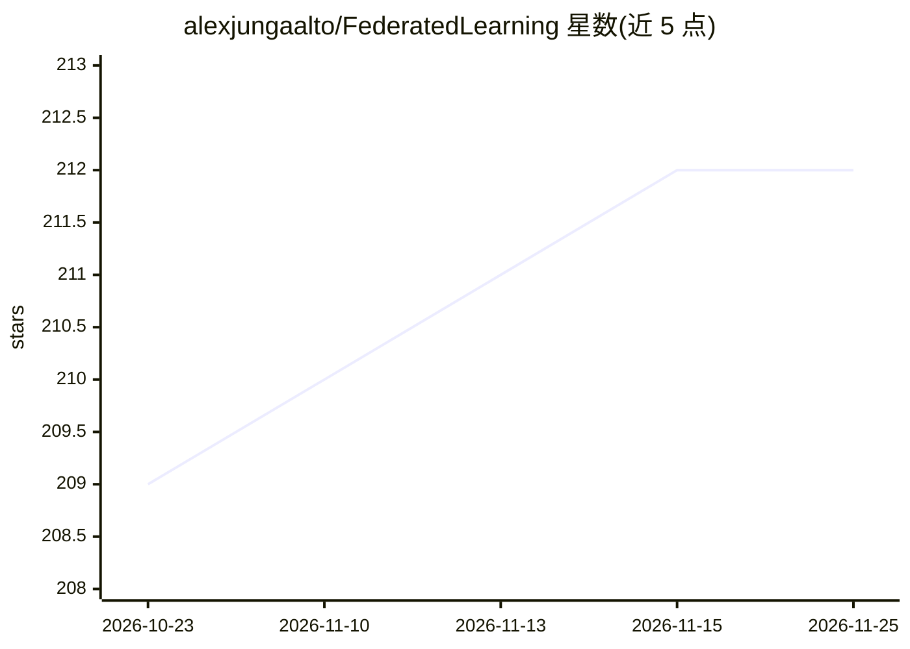

# alexjungaalto/FederatedLearning

⭐ 212 · Jupyter Notebook · 推送 2026-11-12 · [GitHub](https://github.com/alexjungaalto/FederatedLearning) · [官网](https://github.com/alexjungaalto/FederatedLearning) · 组织维护

**Aalto 大学联邦学习硕士课程的开源课件库**

Aalto 大学 CS-E4740《Federated Learning》硕士课程的资料工作台，内容按分布式优化问题建模、FL 算法设计、non-IID 数据、安全聚合等主题组织，配套 Springer 教材。仓库提供讲义幻灯片、Jupyter Notebook 与 Python 演示、作业习题、真实数据集及补充阅读（差分隐私、鲁棒性、个性化）。校外学习者可按开放教育内容自由跟学，通过邮件列表获取更新。各部分材料采用不同许可条款（CC BY 4.0 / MIT）。

## 筛选速览

| 维度 | 判定 | 备注 |
|---|---|---|
| AI 角色 | `ai-knowledge` | 知识聚合/清单类 |
| 许可风险 | `none` | — |
| 部署形态 | `None` |  |
| 模型依赖 | — | README 未给出锁定关系 |
| 硬件要求 | — | 无带数字的原话,不猜 |
| 安装摩擦 | `low` | 无编译、无系统依赖或容器化 |
| 成熟度 | — | 结构信号不足 |

## 能力要点

- 讲义幻灯片、Jupyter Notebook 与 Python 演示配套 Springer 教材
- 提供真实数据集用于动手项目（数据来自芬兰气象研究所）
- 开放教育内容，校外学习者可自由跟学
- 课程材料按 CC BY 4.0 与 MIT 等不同条款分别授权

## 适用场景

- 自学联邦学习的分布式优化与算法设计
- 用课程数据集完成 FL 动手项目
- 查阅差分隐私、安全聚合等专题的补充阅读

## 场景标签

`教程课程` · 领域:学习与行业

## 证据(README 行号)

> L3: Welcome to the GitHub repository for **CS-E4740 - Federated Learning**, a master-level course offered every spring a
> L19: - ✅ **Lecture Slides** (based on the Springer textbook)
> L20: - 📓 **Jupyter Notebooks** and Python demos

## 星数曲线

2026-10-23 209 → 2026-11-25 212（+3）

---
*卡片 v1 · prompt 1.4 · 生成 2026-11-25 · 置信度 high · 依据 README sha `75f0fee179d9` · [字段定义](../../DATASET.md)*
