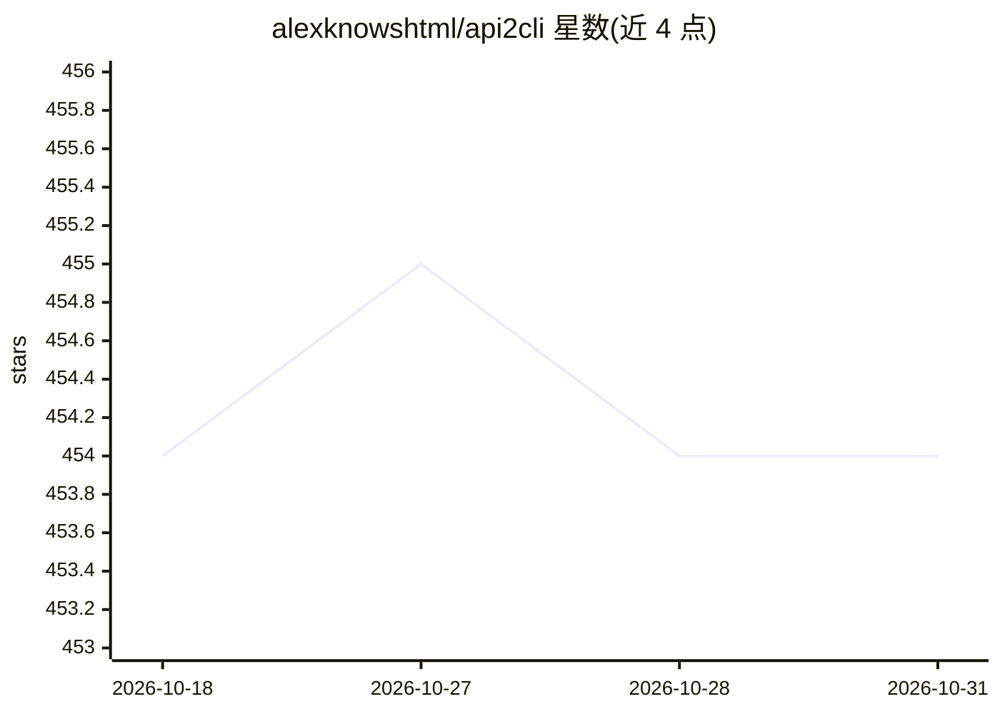

# alexknowshtml/api2cli

⭐ 454 · MIT · 推送 2026-02-20 · [GitHub](https://github.com/alexknowshtml/api2cli) · 个人维护

**Claude Code 技能：把任意 API 文档生成为双模式 CLI 与技能包**

一个 Claude Code 技能（skill），需在 Claude Code 环境内使用，本身非独立工具。由 Claude 完成端点发现（解析文档页、主动探测、读取 peek-api 抓包），建立含认证/分页/限流信息的端点目录，随后生成基于 Commander.js 的双模式 CLI（终端人类可读输出、管道时输出带 next_actions 的 JSON 信封），并生成 SKILL.md 技能包供后续 Claude 会话直接调用。面向希望让 AI agent 通过 CLI 访问 API 的开发者。

## 筛选速览

| 维度 | 判定 | 备注 |
|---|---|---|
| AI 角色 | `ai-ecosystem` | LLM/agent 周边工具 |
| 许可风险 | `permissive` | MIT |
| 部署形态 | `library` | 以包/库形式分发 |
| 模型依赖 | — | README 未给出锁定关系 |
| 硬件要求 | — | 无带数字的原话,不猜 |
| 安装摩擦 | `low` | 无编译、无系统依赖或容器化 |
| 成熟度 | — | 结构信号不足 |

## 能力要点

- 三种端点发现方式：文档解析、主动探测、peek-api 抓包
- 生成每个端点一个子命令的 Commander.js CLI，含认证/分页/重试/限流/缓存
- 双模式输出：终端人类可读，管道时输出 JSON 信封与 next_actions
- 生成带触发短语与工作流示例的 SKILL.md 技能包

## 适用场景

- 让 Claude 从 API 文档自动生成可用的命令行客户端
- 为 AI agent 提供通过 CLI 操作 API 的能力
- 把 peek-api 抓包结果转成 CLI 工具

## 场景标签

`文档解析` `代码生成` · 领域:编码与开发

## 证据(README 行号)

> L3: A Claude Code skill that turns any API into a working CLI, then wraps that CLI in a skill. Point it at API docs, a l
> L5: > **Requires Claude Code** -- this is a skill, not a standalone tool. Claude handles the discovery, generation, and 

## 星数曲线

2026-10-18 454 → 2026-10-31 454（+0）

---
*卡片 v1 · prompt 1.4 · 生成 2026-10-21 · 置信度 mid · 依据 README sha `859ab8aa4865` · [字段定义](../../DATASET.md)*
