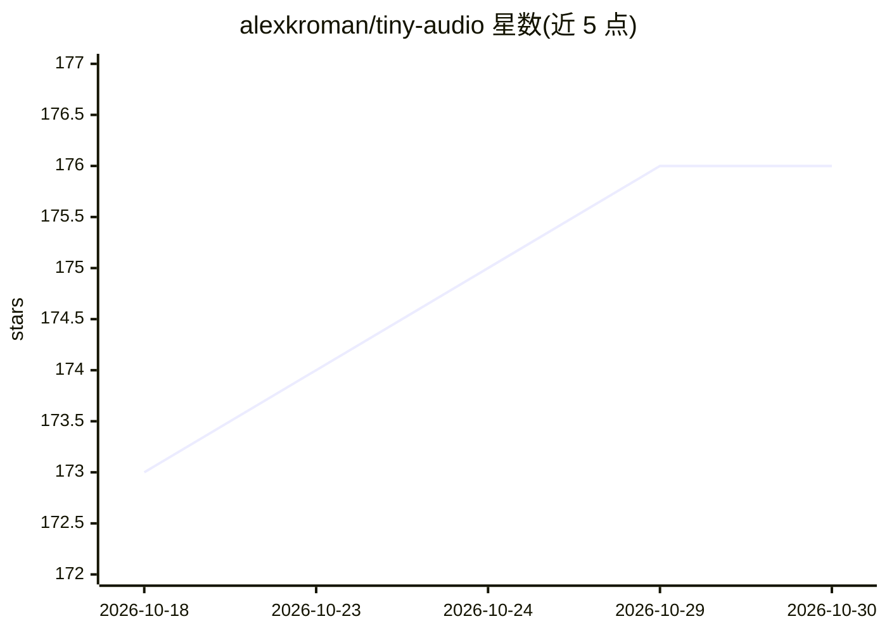

# alexkroman/tiny-audio

⭐ 176 · Python · MIT · 推送 2026-10-23 · [GitHub](https://github.com/alexkroman/tiny-audio) · [官网](https://huggingface.co/spaces/mazesmazes/tiny-audio) · 个人维护

**可低成本训练的语音转文字 LLM 开源实现及配套课程**

由冻结语音编码器、小型 MLP 投影层（唯一从零训练部分）与开源 Qwen LLM 解码器（LoRA）组成的语音转文字模型，附教学课程。默认配方训练约 80M 参数，LibriSpeech test-clean 达 1.8% WER；支持词级时间戳、说话人分离、批量 HTTP 服务（ta serve）。免费配方可在笔记本约 30 分钟训练，完整训练需一块 80GB GPU、成本数百美元。README 声明定位为学习与廉价实验，非生产级方案。提供 Hugging Face 模型、在线 Demo 与 CLI。

## 筛选速览

| 维度 | 判定 | 备注 |
|---|---|---|
| AI 角色 | `ai-native` | 本体是模型或模型工具 |
| 许可风险 | `permissive` | MIT |
| 部署形态 | `library` | 以包/库形式分发 |
| 模型依赖 | — | README 未给出锁定关系 |
| 硬件要求 | `cpu-ok` | |
| 安装摩擦 | `medium` | 含编译或系统依赖之一 |
| 成熟度 | — | 结构信号不足 |

## 能力要点

- 编码器→投影层→LLM 解码器架构，仅训练投影层（约 20 行代码）+ LoRA
- 词级时间戳（强制对齐）与说话人分离输出
- 免费配方支持 Apple Silicon / Colab T4 训练，约 30 分钟、16GB 内存
- 配套课程与 ta CLI（eval/serve/push/deploy/runpod）

## 适用场景

- 学习并亲手构建语音转文字 LLM 的完整流程
- 在单 GPU 上低成本实验 ASR 训练配方
- 自建带词级时间戳与说话人分离的转写服务

## 场景标签

`语音识别` `教程课程` `微调` · 领域:学习与行业

## 证据(README 行号)

> L8: **Build a speech-to-text LLM from scratch, and train it on one GPU.**
> L73: ```text

## 星数曲线



2026-10-18 173 → 2026-10-30 176（+3）


---
*卡片 v1 · prompt 1.4 · 生成 2026-10-22 · 置信度 mid · 依据 README sha `a45d821c0026` · [字段定义](../../DATASET.md)*
