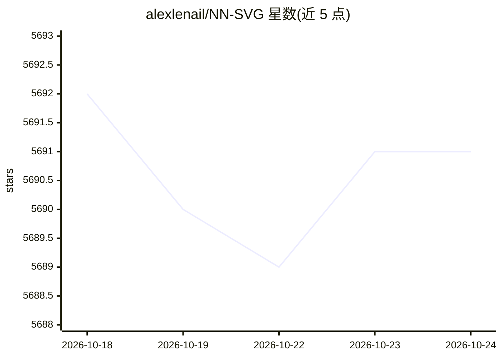

# alexlenail/NN-SVG

⭐ 5,691 · JavaScript · MIT · 推送 2026-06-02 · [GitHub](https://github.com/alexlenail/NN-SVG) · [官网](http://alexlenail.me/NN-SVG/) · 个人维护

**参数化生成神经网络结构图的绘图工具，可导出 SVG**

用于以参数化方式（而非手工）绘制神经网络架构图的工具：支持三类图——全连接网络（FCNN）图、LeNet 风格卷积网络（CNN）图、AlexNet 风格深度网络图；前两者基于 D3 实现，后者基于 Three.js。提供尺寸、颜色、布局等样式参数，图可导出为 SVG 文件，供论文或网页使用。作者称其面向机器学习研究者，亦可作教学用途。有 JOSS 2019 论文引用条目。

## 筛选速览

| 维度 | 判定 | 备注 |
|---|---|---|
| AI 角色 | `ai-ecosystem` | LLM/agent 周边工具 |
| 许可风险 | `permissive` | MIT |
| 部署形态 | `None` |  |
| 模型依赖 | — | README 未给出锁定关系 |
| 硬件要求 | — | 无带数字的原话,不猜 |
| 安装摩擦 | `low` | 无编译、无系统依赖或容器化 |
| 成熟度 | — | 结构信号不足 |

## 能力要点

- 参数化生成 FCNN/LeNet 风格 CNN/AlexNet 风格三类架构图
- 基于 D3 与 Three.js 实现
- 图可导出为 SVG 文件
- 提供尺寸、颜色、布局等样式参数

## 适用场景

- 为学术论文绘制神经网络结构示意图
- 避免手工绘制网络架构图
- 教学场景中展示网络结构

## 场景标签

`科研工具` · 领域:学习与行业

## 证据(README 行号)

> L9: NN-SVG is a tool for creating Neural Network (NN) architecture drawings parametrically rather than manually. It also
> L11: The tool provides the ability to generate figures of three kinds: classic Fully-Connected Neural Network (FCNN) fig

## 星数曲线

2026-10-18 5,692 → 2026-10-24 5,691（-1）

---
*卡片 v1 · prompt 1.4 · 生成 2026-10-20 · 置信度 high · 依据 README sha `140b644431b9` · [字段定义](../../DATASET.md)*
