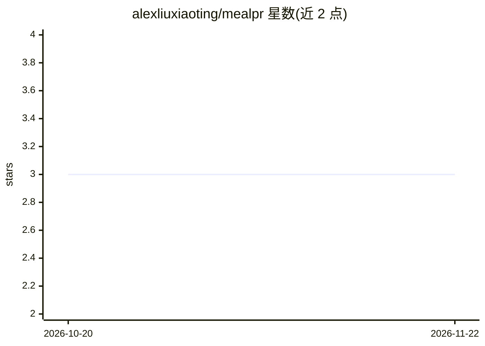

# alexliuxiaoting/mealpr

⭐ 3 · JavaScript · NOASSERTION · 推送 2026-10-10 · [GitHub](https://github.com/alexliuxiaoting/mealpr) · 个人维护 · 中文 README

**把麦当劳 MCP 点餐改造成人工审批的 PR 式工作流**

WorkBuddy Skill：将 AI 通过麦当劳中国 MCP Server 点餐的过程包装为 Pull Request 式流程——AI 基于真实菜单与优惠券提交结构化提案，自动做预算/价格/券/忌口/营养校验，每轮修改输出 Diff，用户批准后（含门店/商品/数量/金额指纹锁定）守卫全部通过才调用 create-order，付款仍由用户完成。scripts 提供 JSON in→JSON/Markdown out 的确定性脚本与 Demo 模式（无需 Token）。注意：README 明确声明写链路（create-order 等）的真实 MCP 集成从未验证。

## 筛选速览

| 维度 | 判定 | 备注 |
|---|---|---|
| AI 角色 | `ai-native` | 本体是模型或模型工具 |
| 许可风险 | `none` | NOASSERTION |
| 部署形态 | `library` | 以包/库形式分发 |
| 模型依赖 | — | README 未给出锁定关系 |
| 硬件要求 | — | 无带数字的原话,不猜 |
| 安装摩擦 | `low` | 无编译、无系统依赖或容器化 |
| 成熟度 | — | 结构信号不足 |

## 能力要点

- Propose→Validate→Review→Approve→Execute 的交易审核模式，批准后任何实质变化自动作废
- Meal Diff：每次修改输出商品/数量/券/金额/营养的结构化差异
- Demo 模式与真实交易结构性隔离（assertExecutable 对 DEMO 一律返回 ok:false）
- 十余个零依赖确定性脚本：意图解析、校验、渲染 PR、Diff、脱敏、状态机

## 适用场景

- 让 AI 代点麦当劳但保留最终批准权
- 点餐前核对预算、优惠券与实付金额
- 在 AI 点餐助手方案中避免重复计价或信息不全时被替做决定

## 场景标签

`工作流自动化` · 领域:效率与自动化

## 证据(README 行号)

> L5: **MealPR turns McDonald's MCP ordering into a reviewable, human-approved agent workflow.**
> L10: > 把 AI 点餐变成一次 Code Review：AI 用麦当劳真实 MCP 数据提交一份结构化的 Meal PR，
> L30: 6. 下单           守卫全部通过才调用 create-order → 你自己完成支付

## 星数曲线

2026-10-20 3 → 2026-11-22 3（+0）

---
*卡片 v1 · prompt 1.4 · 生成 2026-11-22 · 置信度 high · 依据 README sha `5263b8211e62` · [字段定义](../../DATASET.md)*
