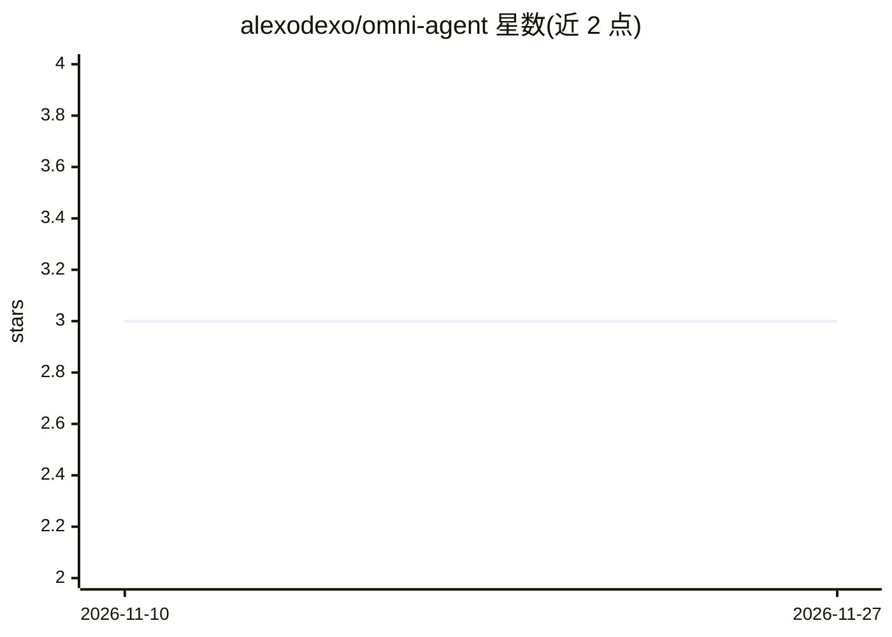

# alexodexo/omni-agent

⭐ 3 · Python · MIT · 推送 2026-11-13 · [GitHub](https://github.com/alexodexo/omni-agent) · 个人维护

**Claude Code 后台委派任务给其他模型与账号的插件**

以 Claude Code 插件形式运行，让主 Claude 把有边界的子任务在后台交给 DeepSeek、Kimi、Ollama、EUrouter、Codex 或其他 Claude 账号执行，结束后生成 report.md 并通知。提供 run/status/result/cancel、review 二次意见与 adversarial-review、可选 review gate、多 Claude 账号配额显示，以及经 ssh 在远程机器上运行（rsync 拷贝项目文件，密钥与 .env 不外传）。零依赖，仅用 Python 标准库，要求 Python 3.9+ 与至少一个 agent CLI。

## 筛选速览

| 维度 | 判定 | 备注 |
|---|---|---|
| AI 角色 | `ai-ecosystem` | LLM/agent 周边工具 |
| 许可风险 | `permissive` | MIT |
| 部署形态 | `None` |  |
| 模型依赖 | local-ok | 支持本地模型 |
| 硬件要求 | — | 无带数字的原话,不猜 |
| 安装摩擦 | `low` | 无编译、无系统依赖或容器化 |
| 成熟度 | — | 结构信号不足 |

## 能力要点

- 后台 detached 运行：主 Claude 继续工作，结束后通知并出报告
- review/adversarial-review：把 git diff 交给另一模型出裁定与分级 findings
- 多 Claude 账号与自定义 provider（providers.d JSON）
- 远程 --host 执行，rsync 拷贝项目副本且密钥不随行

## 适用场景

- 让便宜或本地模型并行跑研究/草稿任务，主 Claude 不中断
- 用另一个模型或账号对当前改动做代码审查二次意见
- 在 Mac mini/服务器上远程执行 agent 任务

## 场景标签

`代码审查` `编码 Agent` `多智能体` · 领域:Agent 开发

## 证据(README 行号)

> L10:  Your Claude hands tasks to other models, other accounts and Codex, in the background, without you waiting.
> L59: |**Swappable agent CLI**|Claude Code, opencode, codex, dsh. Omni-Agent checks which CLI fits which provider|

## 星数曲线

2026-11-10 3 → 2026-11-27 3（+0）

---
*卡片 v1 · prompt 1.4 · 生成 2026-11-22 · 置信度 high · 依据 README sha `d99965b61928` · [字段定义](../../DATASET.md)*
