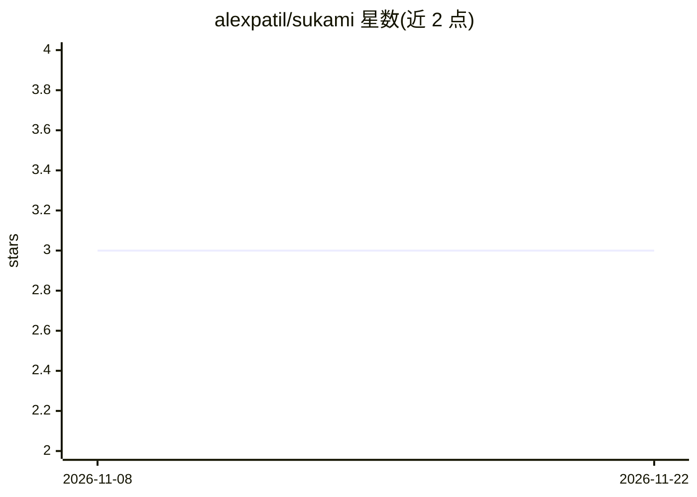

# alexpatil/sukami

⭐ 3 · Go · MIT · 推送 2026-11-13 · [GitHub](https://github.com/alexpatil/sukami) · 个人维护

**Go 实现的 LLM 代理网关：裁剪提示词、语义缓存、按复杂度路由降费**

纯 Go 标准库编写的反向代理，部署在应用与上游 LLM 之间：转发前裁剪对话冗余与多余空白、用内存向量相似度（>0.85）缓存重复查询、可选地将简单提示路由到同上游的经济型模型，复杂提示保留原模型。仅改 base_url 即可接入官方 OpenAI SDK；对 429/502/503/504 透明重试；提供 Prometheus 指标、多租户限流密钥与云安全模式；打包为单个静态二进制，无前端。

## 筛选速览

| 维度 | 判定 | 备注 |
|---|---|---|
| AI 角色 | `ai-ecosystem` | LLM/agent 周边工具 |
| 许可风险 | `permissive` | MIT |
| 部署形态 | `self-host` | docker 或自建部署 |
| 模型依赖 | — | README 未给出锁定关系 |
| 硬件要求 | — | 无带数字的原话,不猜 |
| 安装摩擦 | `low` | 无编译、无系统依赖或容器化 |
| 成熟度 | — | 结构信号不足 |

## 能力要点

- 仅改 base_url 接入官方 OpenAI SDK 的 drop-in 集成
- 内存语义缓存，带实体与反义碰撞防护
- 进程内提示复杂度评估的智能路由（opt-in），无额外 API 调用
- Prometheus 指标含缓存命中率、节省 token 数与美元成本估算

## 适用场景

- 在应用前部署代理以降低 LLM token 开销与延迟
- 为多租户团队分发带限流的 API 密钥并追踪用量
- 利用语义缓存加速重复性查询场景

## 场景标签

`模型网关` · 领域:Agent 开发

## 证据(README 行号)

> L5: **The transparent token optimization data-plane between your applications and upstream LLMs.**
> L7: Sukami is an open-source AI infrastructure proxy in pure Go. It prunes prompt bloat, serves repeated queries from an
> L16: - **Drop-in integration**: Works with official OpenAI SDKs by changing only the `base_url`.

## 星数曲线

2026-11-08 3 → 2026-11-22 3（+0）

---
*卡片 v1 · prompt 1.4 · 生成 2026-11-22 · 置信度 high · 依据 README sha `7db032f4e0e6` · [字段定义](../../DATASET.md)*
