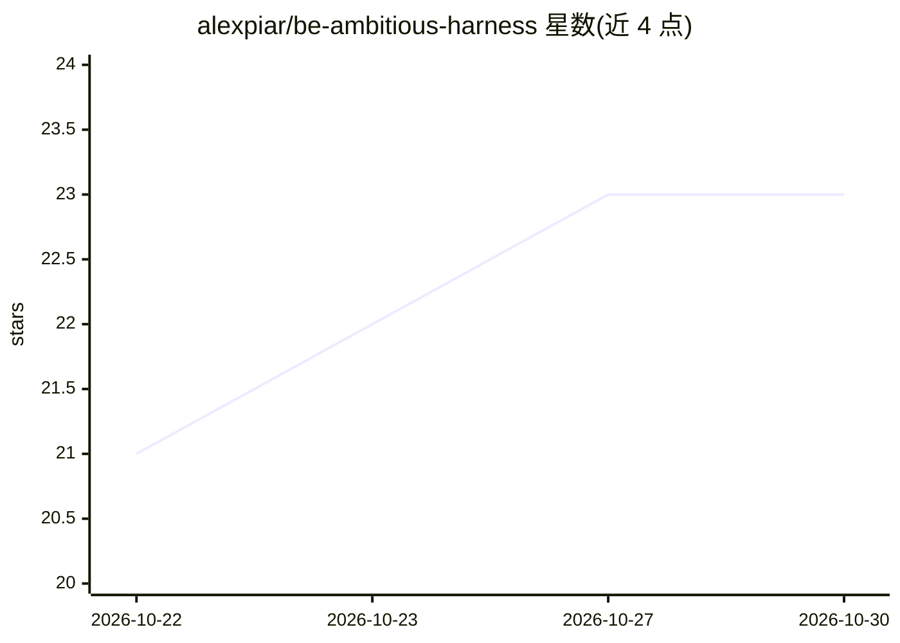

# alexpiar/be-ambitious-harness

⭐ 23 · Python · MIT · 推送 2026-10-25 · [GitHub](https://github.com/alexpiar/be-ambitious-harness) · 个人维护

**Claude Code 技能：planner/worker/verifier 三角色工作流框架**

以纯 markdown 文件形式提供的提示工程框架与多智能体工作流，作为 Claude Code 技能分发（/be-ambitious-harness，英文与俄文），也可被任何能读取 markdown 文件夹的 agent 使用。机制：每个任务设定基线与进阶两条标准；昂贵的进阶分支前先跑带预设通过判据的廉价门检（三种结果：通过/失败/数据不足）；planner 写提示、worker 执行、verifier 只看目标与判据打分且不见 worker 推理，建议换模型验证。含 6 个场景剧本与自测 eval 套件（8 任务、31 判据）。自述 v0.1 三角色一遍约耗单技能两倍的 sub-agent token，一天内的小任务不划算。

## 筛选速览

| 维度 | 判定 | 备注 |
|---|---|---|
| AI 角色 | `ai-ecosystem` | LLM/agent 周边工具 |
| 许可风险 | `permissive` | MIT |
| 部署形态 | `None` |  |
| 模型依赖 | locked-api |  |
| 硬件要求 | — | 无带数字的原话,不猜 |
| 安装摩擦 | `low` | 无编译、无系统依赖或容器化 |
| 成熟度 | — | 结构信号不足 |

## 能力要点

- 双标准（基线/进阶）+ 门检（通过判据先于测试固定）
- planner/worker/verifier 角色隔离，verifier 不见 worker 推理，建议跨模型验证
- 6 个场景剧本（设计/数据/代码/写作/决策/通用）
- 自带 eval 套件：8 个测试任务、31 项评分卡

## 适用场景

- 让 Claude Code 或其他 agent 在控制成本与验证的前提下执行更有野心的任务
- 在开始昂贵工作前用廉价门检判断进阶目标是否值得
- 为代码、数据分析、写作等场景套用带独立验证的多角色工作流

## 场景标签

`多智能体` `提示工程` · 领域:Agent 开发

## 证据(README 行号)

> L9: ## What it is: a prompt engineering framework, a Claude Code skill, a multi-agent workflow
> L13: Be-Ambitious Harness is a **prompt engineering framework and multi-agent workflow** that turns any task into a prom
> L21: It ships as a **Claude Code skill** (`/be-ambitious-harness`) in **English and Russian**, and works with any agent 

## 星数曲线

2026-10-22 21 → 2026-10-30 23（+2）

---
*卡片 v1 · prompt 1.4 · 生成 2026-10-27 · 置信度 high · 依据 README sha `79ca1222f34a` · [字段定义](../../DATASET.md)*
