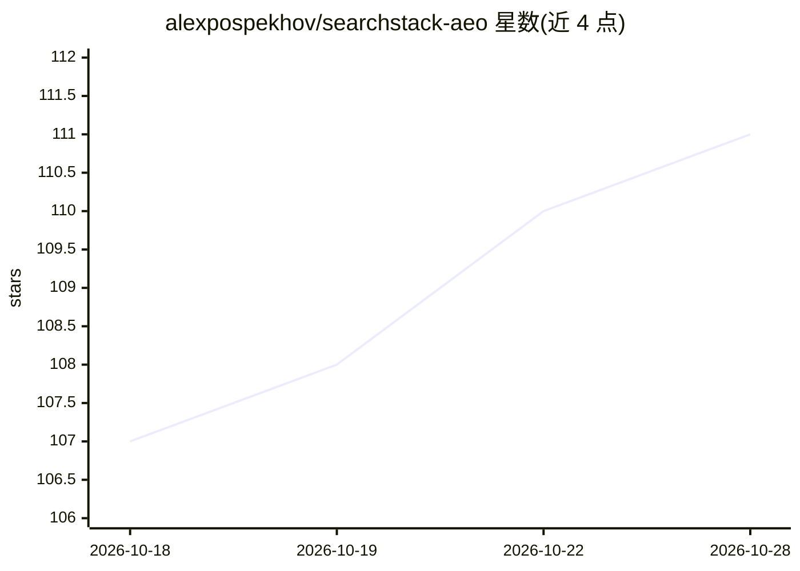

# alexpospekhov/searchstack-aeo

⭐ 111 · Python · MIT · 推送 2026-09-29 · [GitHub](https://github.com/alexpospekhov/searchstack-aeo) · [官网](https://github.com/alexpospekhov/searchstack-aeo#readme) · 个人维护

**面向 AI 原生创始人的 AEO/GEO/SEO 可见性监控 CLI**

Python 编写的命令行工具，用于监控网站在 Google、Google AI Overview、ChatGPT、Perplexity、Claude、Grok 及本地 LLM（Ollama/LM Studio/vLLM 等）中的引用与排名可见性。功能覆盖 GSC 排名查询、关键词研究（DataForSEO）、外链分析、技术审计、IndexNow/Bing 提交、llms.txt 生成、快照对比与 14 节 Markdown 报告。集成 12 个服务，全部可选，命令自动跳过未配置的服务；部分命令（sitemap 爬取类）无需任何 API key。面向独立开发者、创始人与代理运营者，支持 cron 定时部署。

## 筛选速览

| 维度 | 判定 | 备注 |
|---|---|---|
| AI 角色 | `ai-ecosystem` | LLM/agent 周边工具 |
| 许可风险 | `permissive` | MIT |
| 部署形态 | `self-host` | docker 或自建部署 |
| 模型依赖 | local-ok | 支持本地模型 |
| 硬件要求 | — | 无带数字的原话,不猜 |
| 安装摩擦 | `low` | 无编译、无系统依赖或容器化 |
| 成熟度 | — | 结构信号不足 |

## 能力要点

- 跨 5 家 AI 提供商 + 本地 LLM 的引用检测（AEO）与 Google AI Overview 监控（GEO）
- llms.txt 生成器（遵循 llmstxt.org 规范）与校验命令
- 本地 LLM 支持任意 OpenAI 兼容服务器（Ollama/LM Studio/vLLM/llama.cpp/LocalAI），离线免 key 运行
- 14 节 Markdown 报告与快照 diff（引用增减、排名变化）

## 适用场景

- 检查 ChatGPT/Perplexity/Claude 等是否在相关提问中引用我的网站
- 定时生成 SEO/AEO/GEO 报告并推送到 Slack/邮件
- 用本地模型离线测试品牌在开源 LLM 中的呈现方式

## 场景标签

`网页抓取` · 领域:效率与自动化

## 证据(README 行号)

> L9: Monitor your visibility across Google, AI Overviews, ChatGPT, Perplexity & Claude — from one CLI.
> L52: - **AEO Monitor** — check if ChatGPT, Perplexity, Claude, Grok, and **local models (Ollama/Qwen/Llama)** cite your 
> L69: - **Local LLM Support** — run AEO checks against Ollama, LM Studio, vLLM, or any OpenAI-compatible local model. Tes

## 星数曲线

2026-10-18 107 → 2026-10-28 111（+4）

---
*卡片 v1 · prompt 1.4 · 生成 2026-10-23 · 置信度 mid · 依据 README sha `d6c5415319d0` · [字段定义](../../DATASET.md)*
