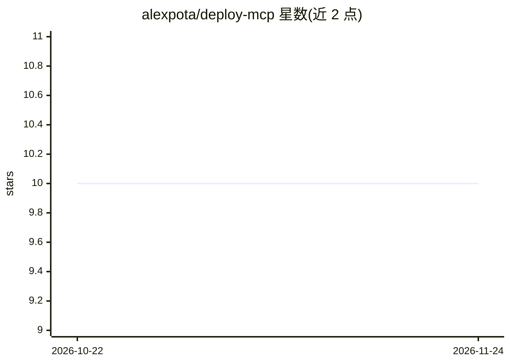

# alexpota/deploy-mcp

⭐ 10 · TypeScript · Apache-2.0 · 推送 2026-05-09 · [GitHub](https://github.com/alexpota/deploy-mcp) · [官网](https://deploy-mcp.io) · 个人维护

**给 AI 助手查部署状态的 MCP 服务器**

一个面向 AI 助手的 MCP 服务器：通过配置各部署平台的 API token，让用户在 AI 对话中查询部署状态、日志、历史与实时进度，无需切换到平台控制台。支持 Vercel、Netlify、Cloudflare Pages 多平台同时接入，token 仅存本机、只读权限、无遥测。提供 npx 启动或全局 npm 安装，另提供基于 deploy-mcp.io 端点的 shields.io 部署状态徽章与 webhook 实时更新；GitHub Pages 平台标注为即将支持。

## 筛选速览

| 维度 | 判定 | 备注 |
|---|---|---|
| AI 角色 | `ai-ecosystem` | LLM/agent 周边工具 |
| 许可风险 | `permissive` | Apache-2.0 |
| 部署形态 | `library` | 以包/库形式分发 |
| 模型依赖 | — | README 未给出锁定关系 |
| 硬件要求 | — | 无带数字的原话,不猜 |
| 安装摩擦 | `low` | 无编译、无系统依赖或容器化 |
| 成熟度 | — | 结构信号不足 |

## 能力要点

- 通过 MCP 协议向 Claude Desktop/VS Code/Cursor/Windsurf/Continue.dev/Cline 提供 5 个部署查询工具
- 同时接入 Vercel、Netlify、Cloudflare Pages 多平台，按命令自动匹配平台
- 实时 watch_deployment 监控与部署对比工具
- shields.io 端点徽章与 webhook 实时状态更新

## 适用场景

- 在 Claude Desktop 里直接问『我的 Vercel 部署成功了吗』
- 让 AI 助手实时盯 CI 部署进度并读日志
- 给仓库 README 加实时部署状态徽章

## 场景标签

 · 领域:开发者工具/部署监控

## 证据(README 行号)

> L3: **Universal Deployment Tracker for AI Assistants**
> L5: Track deployments across all platforms directly in your AI conversation.
> L156: deploy-mcp works with any MCP-compatible AI assistant. Here's how to set it up:

## 星数曲线

2026-10-22 10 → 2026-11-24 10（+0）

---
*卡片 v1 · prompt 1.4 · 生成 2026-11-20 · 置信度 high · 依据 README sha `655a75184326` · [字段定义](../../DATASET.md)*
