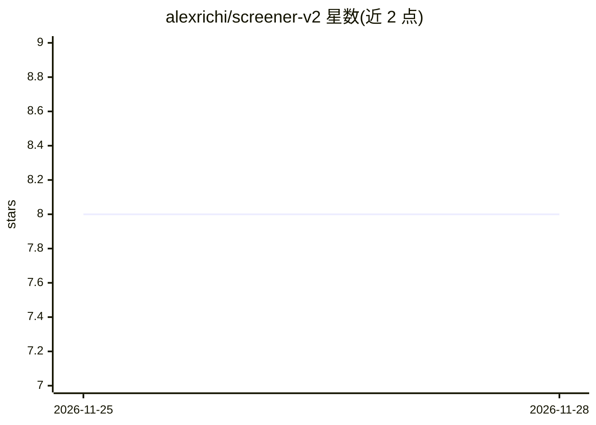

# alexrichi/screener-v2

⭐ 8 · TypeScript · MIT · 推送 2026-11-27 · [GitHub](https://github.com/alexrichi/screener-v2) · 个人维护

**多交易所加密行情筛选桌面应用，带 AI 助手侧栏**

基于 Vite + React + TypeScript 的多交易所加密货币行情筛选器，覆盖 Binance、OKX、Bybit、Bitget、Hyperliquid 与 Coinbase 的公开 REST/WS 行情数据。核心机制：本地 sidecar 进程归一化各所数据并维护技术指标序列，Pine Script 本地编译器/运行时支持指标编写与扫描，Vela 多图表工作区与盘口/成交流视图。AI 助手通过用户自填的 OpenAI 兼容端点（base URL、模型、key）接入，支持读取图表、编辑调试 Pine 脚本、绘制图形，需模型具备工具调用能力。无私有后端，Electron 提供桌面打包。

## 筛选速览

| 维度 | 判定 | 备注 |
|---|---|---|
| AI 角色 | `ai-enhanced` | 去掉 AI 部分产品仍成立 |
| 许可风险 | `permissive` | MIT |
| 部署形态 | `desktop` | 安装包/桌面程序 |
| 模型依赖 | local-ok | 支持本地模型 |
| 硬件要求 | — | 无带数字的原话,不猜 |
| 安装摩擦 | `low` | 无编译、无系统依赖或容器化 |
| 成熟度 | — | 结构信号不足 |

## 能力要点

- 六所公开行情数据经 VenueAdapter 归一化，多图表工作区最多 4×4
- 本地 MIT Pine Script 编译器/运行时，支持指标编写、扫描与实时调试
- AI 助手支持任意 OpenAI 兼容端点（OpenRouter/本地 Ollama/LM Studio），可读写 Pine 脚本、附加图表截图
- Whisper 兼容转录模型启用麦克风语音输入

## 适用场景

- 同时监控多个交易所的合约与现货行情并按指标筛选
- 编写 Pine Script 指标并让 AI 助手代为调试与修改
- 本地模型离线使用 AI 助手分析当前图表

## 场景标签

`AI 助手` `金融量化` · 领域:对话与助手

## 证据(README 行号)

> L3: A multi-venue crypto screener (Binance, OKX, Bybit, Bitget, Hyperliquid,
> L62: Any OpenAI-compatible endpoint works: OpenRouter, a local Ollama/LM Studio, or a

## 星数曲线

2026-11-25 8 → 2026-11-28 8（+0）

---
*卡片 v1 · prompt 1.4 · 生成 2026-11-24 · 置信度 high · 依据 README sha `664073172847` · [字段定义](../../DATASET.md)*
